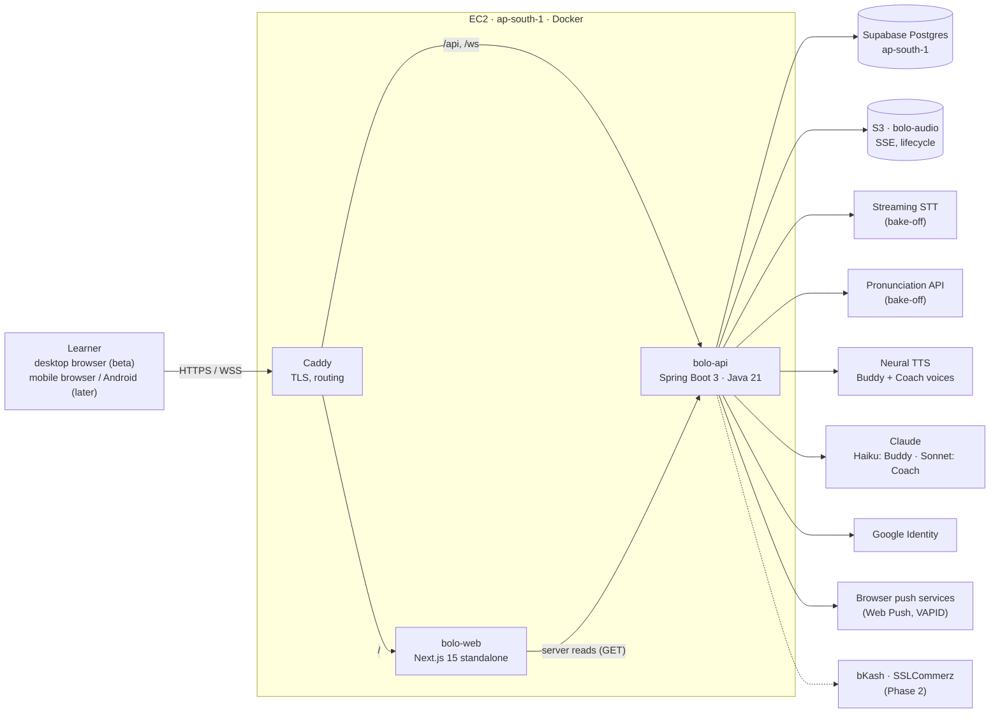
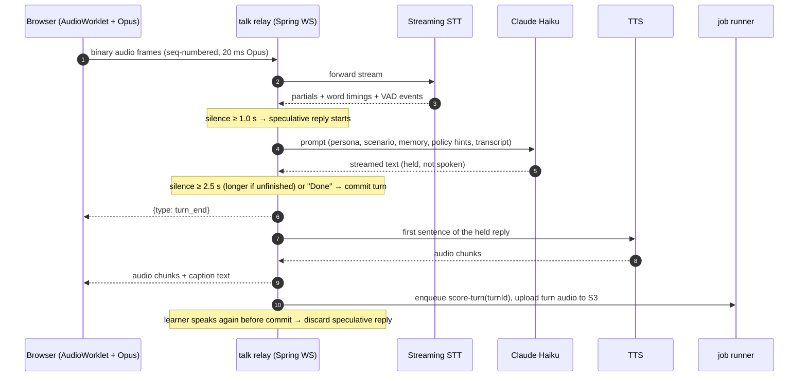
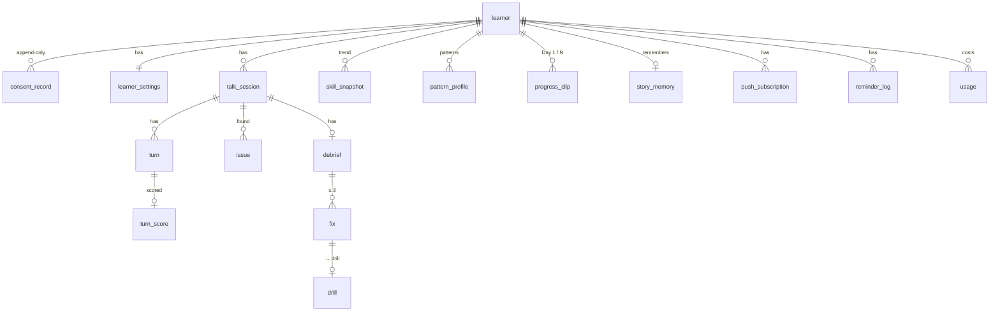
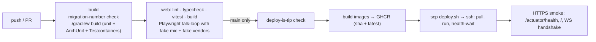
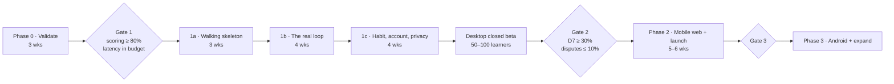

# Bolo — Solution Architecture and Delivery Plan (MVP)

Nov 7, 2026 · draft for review · builds on [Bolo-PRD-MVP.md](Bolo-PRD-MVP.md) and the locked v1 prototypes

## 0. The short version

- **One Spring Boot app, one Next.js app, one EC2 box.** This is the medscribe-ai deployment shape: Docker, Caddy, GitHub Actions, GHCR, SSH deploy, Supabase Postgres and S3, all in ap-south-1 (Mumbai, about 40 ms from Dhaka). No Kubernetes, queues or identity provider.
- **Hexagonal modules inside one deployable.** We use package-per-module with `port.in` `*UseCase` and `port.out` `*Port`, and ArchUnit keeps the boundaries. There are 8 business modules and 3 platform modules.
- **The voice loop is cascaded and runs through Java.** Browser → WebSocket → Spring relay → streaming STT → Claude → streaming TTS → browser. We own turn-taking, safety and scoring. Speech-to-speech "realtime" models are rejected because they take away exactly the control the PRD asks for (TLK-3/4/5/6/7, ASM-*).
- **Scoring happens during the talk, not after it.** Every turn is scored in the background while the learner keeps talking. When the session ends, only ranking and the Coach's write-up remain, which is how the debrief stays ≤ 15 s (ASM-7).
- **Phase 0 builds real code, not throwaway.** The scoring bake-off harness is the `assessment` module, and the latency spike is the `talk` relay. Gate 1 is decided by code that we then ship.
- **Build order follows the 7 Nov decision:** desktop browser closed beta → mobile browser (PWA) → Android (TWA wrapper first, native only if the data demands it).

## 1. Where I disagree with the brief (read first)

| # | Topic | My recommendation | Why |
| --- | --- | --- | --- |
| 1 | **Kubernetes** | Don't use it for the MVP. Run one EC2 box with Docker, the same as medscribe-ai. Move to ECS or EKS only when one box can't carry the concurrent talks, or when a second engineer needs isolated environments. | The beta is 50–100 learners. A voice relay is I/O-bound, because the vendors do the heavy compute, so a 2 vCPU box carries hundreds of concurrent talks. EKS adds a control plane, nodes, an ALB and a NAT gateway, plus ops time, and buys nothing at this scale. |
| 2 | **Reactive** | Spring MVC on **Java 21 virtual threads** with JDBC (`JdbcClient` / Spring Data JDBC), not WebFlux/R2DBC. | Medscribe's reactive stack caused friction: sync S3 on `boundedElastic`, a separate JDBC connection for Flyway, functional routing. Virtual threads give the same concurrency with straight-line code, which matters most in the streaming relay. |
| 3 | **The PRD is still Android-first** | Update the PRD to match the browser-first decision before Phase 1 starts. See the list in §11. | Several P0 rules are written in Android terms: TalkBack, 2 GB RAM, APK size, OTP auto-read, the share sheet, "kill the app". QA will test against the PRD. |
| 4 | **NFR-1 measures from "turn ends"** | Define it as "from the end-of-turn decision". Then hide the LLM time inside the silence window with **speculative generation** (§4.3). | TLK-4 waits ≥ 2.5 s of silence. If NFR-1 is measured from when the learner stops speaking, the silence floor alone breaks the 1.5 s target. |
| 5 | **Barge-in only with earbuds (TLK-15)** | A browser can't reliably tell earbuds from speakers. Ask once in the mic picker ("Using headphones?"), keep barge-in off by default, and auto-disable it if echo is detected. | `enumerateDevices()` labels are only a heuristic. Laptop speakers feed Bolo's voice back into the mic. |
| 6 | **Phone OTP in the closed beta** | Beta uses Google sign-in only; phone OTP arrives in Phase 2. | Beta users are invited desktop users, almost all with Google accounts. SMS OTP to Bangladesh brings a gateway, cost and deliverability work for no learning. When OTP lands, reuse the medscribe OTP design (hashed codes, rate limits). |

## 2. System context



Rules carried over from medscribe-ai:

- **Java owns every rule.** This covers the Home priority table, rating cadence, reminder rules, talk allowance, silence timers and fix ranking. Next.js renders the display model Java returns and derives nothing.
- The browser writes directly to Java through Caddy; Next.js never proxies a request body. Server components read through a `server-only` GET client that forwards only the cookie.
- Provider selection is by property, not by code. Nothing above `adapter.out` imports a vendor SDK type.
- Logs never contain transcript text or audio. Sizes, ids and durations are logged at INFO.

## 3. Backend: modules and code layout

### 3.1 Modules

One Gradle project, `bolo-api`. Each module is a top-level package under `app.bolo`.

| Module | Owns | Main use cases (`port.in`) | Outbound ports (`port.out`) | PRD |
| --- | --- | --- | --- | --- |
| `learner` | Guest and account identity, cookie sessions, Google sign-in, guest→account linking, consent records (append-only, policy version), onboarding answers, goals, settings, data deletion | `StartGuestUseCase`, `SignInWithGoogleUseCase`, `RecordConsentUseCase`, `UpdateSettingsUseCase`, `RequestDeletionUseCase` | `LearnerPort`, `ConsentLedgerPort`, `GoogleTokenVerifierPort` | ONB, ACC-1/2/3/4/7, SET |
| `talk` | Talk sessions, the WebSocket relay, turn-taking policy, Buddy brain (prompts, persona, scenarios, story memory), safety guard, pause/resume | `StartTalkUseCase`, `ResumeTalkUseCase`, `EndTalkUseCase`, `TalkQueryUseCase` | `TalkSessionPort`, `TurnPort`, `StoryMemoryPort` | TLK, SCN, PRS-5 |
| `assessment` | Per-turn scoring, Bangla-pattern detection, fluency metrics, sentence and vocabulary rubric, confidence, top-3 ranking, the Phase 0 harness | `ScoreTurnUseCase`, `RankSessionIssuesUseCase`, `ScoreAttemptUseCase` ("Try it") | `TurnScorePort`, `IssuePort`, `SuppressionPort` | ASM, NFR-10/11 |
| `coaching` | Debrief composition (strength, fix cards, model clips), disputes, skill levels, rating cadence, drills (generate, attempt, skip queue, retire) | `ComposeDebriefUseCase`, `DebriefQueryUseCase`, `DisputeFixUseCase`, `DrillUseCase`, `RateSessionUseCase` | `DebriefPort`, `DrillPort` | DBF, DRL |
| `progress` | Skill trends, personal pattern profile, history, Day 1 vs Day N clips, streak (P1) | `ProgressQueryUseCase`, `RecordProgressClipUseCase`, `HistoryUseCase` | `SkillSnapshotPort`, `PatternProfilePort`, `ProgressClipPort` | PRG-1/2/3/4/8 |
| `home` | Read-only composer of "one primary, at most one secondary" | `HomeQueryUseCase` | — (calls other modules' `port.in` only) | HOM-1, US-6.9, PRG-7 |
| `engagement` | Reminder slots, Web Push subscriptions, send rules, ignored-reminder back-off, "we're here" message | `SetReminderUseCase`, `SubscribePushUseCase`, `ReminderSweepUseCase` | `PushSenderPort`, `ReminderPort` | PRG-5/6 |
| `billing` *(Phase 2)* | Plans, talk-allowance ledger, payments, invites | `AllowanceUseCase`, `CheckoutUseCase`, `InviteUseCase` | `PaymentGatewayPort` (bKash, SSLCommerz), `AllowancePort` | ACC-5/6/8 |
| **Platform** | | | | |
| `speech` | Vendor-neutral speech: streaming STT, TTS, pronunciation assessment, cached model audio | `StreamTranscriptionUseCase`, `SynthesizeUseCase`, `AssessPronunciationUseCase` | One adapter per vendor | — |
| `llm` | `LlmClient` (stream + JSON-schema output), `MeteredLlmClient`, prompt templates | `LlmClient` | Anthropic SDK adapter | — |
| `media` | Audio objects, presigned URLs, retention classes, deletion sweeps | `AudioStoreUseCase`, `RetentionSweepUseCase` | `ObjectStorePort` (S3 / MinIO) | NFR-13/14, ACC-4 |
| `common` | errors, `BoloClock` (Asia/Dhaka), redact, the **job runner** (§3.4), the **usage ledger** (§3.5) | | | NFR-22 |

### 3.2 Package shape (same as medscribe `storage`)

```
app/bolo/assessment/
  domain/                         TurnScore, Issue, SoundPattern (enum: V_BH, Z_J, S_SH, TH_TD, W_V, S_CLUSTER_VOWEL),
                                  SkillLevel, Confidence, IssueRanker (pure, no Spring)
  application/port/in/            ScoreTurnUseCase, RankSessionIssuesUseCase, ScoreAttemptUseCase
  application/port/out/           TurnScorePort, IssuePort, SuppressionPort
  application/service/            TurnScoringService, SessionRankingService, AttemptScoringService
  adapter/in/web/                 AttemptController            (POST /api/attempts)
  adapter/in/cli/                 GoldenSetRunner              (Phase 0 harness, `--spring.profiles.active=harness`)
  adapter/out/persistence/        TurnScoreEntity, JdbcTurnScoreAdapter, ...
  config/                         AssessmentConfiguration
```

Conventions kept from medscribe-ai: domain objects are `record`s; injection uses `@RequiredArgsConstructor`; entities map manually with `from(record)` / `toRecord()`, so there's no MapStruct; enums map through `dbValue()`. We use `@RestController` instead of functional routing, because there's no WebFlux.

### 3.3 Module boundaries (ArchUnit)

The 3 medscribe layer rules carry over unchanged: domain imports nothing, application never imports adapter, and services never touch repositories. Bolo adds one cross-module rule:

```java
// A module may only reach into another module through its application.port.in package.
slices().matching("app.bolo.(*)..").should().notDependOnEachOther()
    .ignoreDependency(resideInAPackage("app.bolo.(*).."), resideInAPackage("..application.port.in.."))
    .ignoreDependency(alwaysTrue(), resideInAPackage("app.bolo.common.."));
```

Add one more invariant rule: **only `media` imports the S3 SDK; only `speech` and `llm` import vendor SDKs.** Unlike medscribe, there's no rule per invariant until an incident earns one.

### 3.4 Async work: a Postgres job table, no queue

Medscribe uses fire-and-forget calls plus startup recovery. Bolo needs retries (US-3.7 retries twice) and must survive restarts mid-scoring, so it uses one durable table:

```sql
create table job (
  id bigserial primary key, kind text not null, payload jsonb not null,
  status text not null default 'ready',  -- ready | running | done | failed
  attempts int not null default 0, max_attempts int not null default 3,
  run_after timestamptz not null default now(), locked_until timestamptz, last_error text,
  dedupe_key text unique                  -- e.g. 'score-turn:{turnId}'
);
```

A `@Scheduled` poller claims work with `FOR UPDATE SKIP LOCKED` and runs each job on a virtual thread with backoff. Job kinds: `score-turn`, `rank-and-compose`, `story-memory`, `notify-debrief-ready`, `retention-sweep`, `delete-learner`, `reminder-sweep`. That's all the queueing the MVP needs. Move to SQS only when more than one app instance runs.

### 3.5 Usage ledger (NFR-22, from day 1)

Keep medscribe's `MeteredLlmClient` idea and extend it to speech. Every vendor call writes `usage(learner_id, session_id, vendor, kind, units, unit_type, usd_micros, at)`, where `unit_type` is tokens, audio seconds or characters. **Cost per loop** is then one SQL query. That query sets the Basic, Premium and Ultimate talk limits, which are still open in the PRD. Prices are config values, kept current from each vendor's price API or invoice.

## 4. The voice loop (the hard part)

### 4.1 Turn pipeline



### 4.2 Responsibilities

| Concern | Where | Notes |
| --- | --- | --- |
| Capture | Browser | `getUserMedia` with echoCancellation, noiseSuppression and autoGainControl on. An AudioWorklet feeds a **WASM Opus encoder**, so every browser, Safari included, sends the same format at about 1.5 MB per 10 minutes (NFR-6). |
| End of turn (TLK-4) | Server | The STT vendor's endpointing or semantic-turn signal, plus our rules: a 2.5 s floor, a longer wait when the partial ends on a conjunction, filler or rising pattern, and "Done" ends the turn at once. Every threshold is in config, so tuning needs no redeploy. |
| Silence prompts 8 / 15 / 45 s (TLK-6, AX-7/8) | Server | The server knows whose turn it is; the client only renders. Learner settings apply here: 2×, off, and "I stammer". |
| Short answers, Bangla detected, repeat or slow down (TLK-5/7/13) | Server rules → prompt hints | Java decides *that* a starter or nudge is needed; the LLM writes the line. "Sorry?" and "Slower please" are matched in Java and replay or re-synthesise without an LLM call. |
| Safety (TLK-14, NFR-21) | Server | A cheap classifier call runs **in parallel** with the reply on each committed transcript. If it flags a crisis, the relay drops the reply and plays the **approved, static** crisis script with local helplines. That script is content, never generated. |
| Story memory (TLK-11) | Job at session end | Haiku extracts `{topic, open_hooks[]}` into `story_memory`. The next session's opening line uses it. |
| Captions (TLK-8) | Relay | Text is streamed in step with the TTS sentence chunks. |
| Stereo placement, ambient ducking (PRS-4/5) | Browser | A Web Audio `StereoPannerNode` and a gain envelope on the ambient track. No server work. |
| Pause, resume, drops (TLK-10, US-2.12, NFR-9) | Both | A hidden tab sends `pause` and closes the mic. The client buffers unacked frames in memory and IndexedDB, and resends from the last acked `seq` on reconnect. If a drop lasts over 20 s, the session moves to `paused`. Each committed turn is persisted at once, so turns already spoken always count. |
| Barge-in (TLK-15) | Both | Only if the learner said "headphones" in the mic picker. The client's VAD sends `barge_in`, and the relay cancels TTS and the LLM stream. |

### 4.3 Latency budget (NFR-1: ≤ 1.5 s median, ≤ 2.5 s p90)

| Step | Without speculation | With speculation |
| --- | --- | --- |
| STT finalisation | 150–300 ms | Already done during the silence |
| LLM first sentence (Haiku, a short reply) | 400–800 ms | Already done during the silence |
| TTS first audio | 150–350 ms | 150–350 ms |
| Network, browser ↔ Mumbai ↔ vendor | 100–300 ms | 100–300 ms |
| **Learner hears Bolo** | **0.8–1.75 s** | **0.25–0.65 s** |

Speculative generation costs extra LLM tokens when the learner resumes after 1 s of silence. The usage ledger tracks that waste, and the 1.0 s trigger is tunable. **Vendor region matters more than code:** pick STT and TTS vendors with an Asia endpoint. Phase 0 measures this from Dhaka on real 4G.

**Escape hatch.** If the Java relay can't hit the budget in Phase 0, replace only the transport. A LiveKit Agents or Pipecat (Python) worker would sit behind the same `talk` ports, and Java would keep the rules, prompts and persistence. Decide this in Phase 0, not later.

### 4.4 WebSocket protocol (`/ws/talk/{sessionId}`, cookie auth plus an Origin check)

| Direction | Message |
| --- | --- |
| C → S | binary `audio(seq, opus)` · `done` · `pause` · `resume` · `repeat` · `barge_in` · `ping` |
| S → C | `ack(seq)` · `state(listening \| thinking \| buddy_speaking \| your_turn)` · `caption(text, final)` · binary `buddy_audio` · `hint(starters[])` · `silence_prompt(level)` · `wrap_up` · `ended(reason)` · `paused(reason)` |

## 5. Assessment and coaching

### 5.1 Per turn (`score-turn` job, while the talk continues)

1. **Transcript and word timings** come from the streaming STT, so there's no second transcription.
2. **Pronunciation:** send the turn audio, with the transcript as the reference text, to the pronunciation API, which returns per-phoneme scores.
3. **Bangla pattern detector**, deterministic Java in `domain`. It maps low target-phoneme scores in context onto the 6 ASM-2 patterns, and flags only *swaps that hurt clarity*, never accent (US-3.2). Each pattern carries a clarity weight; minimal-pair collisions like *very/berry* rank higher.
4. **Confidence:** a function of the phoneme score margin, the STT word confidence, the turn's SNR and overlapping-voice flags (US-3.6). Anything below the threshold is stored but never shown (ASM-5).
5. **Fluency:** deterministic, from word gaps. Words per minute, pauses over 1.2 s and fillers from a lexicon. Under "I stammer", repetitions and blocks are excluded (AX-8).
6. **Sentence building and vocabulary:** one Haiku call with JSON-schema output, validated with networknt as in medscribe. It returns rubric levels plus *one-step-better* upgrade candidates of ≤ 25 words (US-4.4).

### 5.2 At session end (`rank-and-compose` job, target ≤ 15 s p90)

1. Wait for the remaining `score-turn` jobs; usually only the last turn is still running.
2. If total speech is under 60 s, stop with `too_short` (ASM-6).
3. Apply `IssueRanker`, a pure function that's easy to test: frequency × impact, at most 2 sound fixes, at least one sentence or habit fix, a scenario fix replaces the lowest-ranked, improved repeats are dropped, and the disputed-word suppression list applies.
4. **The Coach writes** in one Sonnet call with schema output: the strength, which must cite a real moment, the tips and the final upgrade wording. A banned-word check runs on the output (R6/R9).
5. **Model clips:** Coach-voice TTS runs in parallel. Minimal-pair and drill audio is a **pre-generated library** cached in S3, at no cost per learner.
6. Persist the debrief, mark the loop countable once it's heard, generate up to 3 drills, and run `notify-debrief-ready` if the learner left.

Own-voice clips aren't cut on the server. The client plays `[startMs, endMs]` of the turn file through Web Audio, so there's no ffmpeg on the box.

### 5.3 "Try it" and drills (NFR-3: ≤ 2 s)

`POST /api/attempts` takes a short multipart clip and the known reference. The service runs pronunciation assessment in **scripted mode**, which is more accurate than unscripted, and maps the result to Nailed it / Closer / Once more. Shadowing and "say it better" add a fluency comparison. "Say it better" round 3 checks whether the meaning matches: a small Haiku call that does semantic matching, not word matching.

## 6. Data model (Postgres, one `bolo` schema, Flyway)



Notes:

- `learner(kind GUEST|ACCOUNT, google_sub, linked_from)`. A guest is a real row from the first visit (ACC-2, scored on the server). Sign-in links the guest row, so its data carries over with no copy step (US-8.1).
- `turn(audio_key, retention_class, started_ms, ended_ms, words jsonb, latency_ms, cutoff boolean)`. `latency_ms` and `cutoff` drive NFR-1 and NFR-12 straight from SQL.
- `analytics_event(name, learner_id, session_id, props jsonb, at)`. The PRD's 30 events, written by Java and by the browser through `POST /api/events`. The 7 success metrics are **SQL views**. There's no third-party analytics script, which suits the discretion goal (a tab titled only "Bolo") and the CSP, and keeps data in region. Add Metabase later if needed.
- Safety as constraints, as in medscribe: at most one active session per learner (a partial unique index), `fix.rank between 1 and 3`, and a consent row required before any `turn` exists (a trigger, NFR-16).

## 7. Privacy, security and storage

| Need | Design |
| --- | --- |
| Consent before audio (NFR-16) | The relay refuses `/ws/talk` unless a consent row exists for the current policy version. |
| Keep: No (audio deleted ≤ 24 h) | S3 key tagged `retention=short`. An hourly `retention-sweep` job deletes it explicitly, with a 1-day lifecycle rule as backstop. S3 lifecycle alone isn't precise enough to promise 24 h. |
| Keep: Yes (90 days) | Tagged `retention=standard`, with a 90-day lifecycle rule plus the sweep. |
| Delete one recording / everything (ACC-4, ≤ 7 days) | The `delete-learner` job deletes S3 objects and rows at once, and a schema-derived sweep test, medscribe's `DeletionSweep` pattern, proves every learner-owned table is covered. |
| Guest Day 1 clip on the device (ONB-4) | IndexedDB in the browser, uploaded after sign-in only if Keep is Yes. Browsers may evict IndexedDB; the copy on the "Not now" screen already warns about losing guest data. |
| Encryption (NFR-13) | TLS through Caddy; SSE on S3 (AES-256); Supabase encrypts at rest. |
| No training on voice (NFR-15) | Vendor bake-off criterion: zero retention or no-training terms are a must-pass, as in DR-43. |
| Auth | HttpOnly, Secure, SameSite=Lax session cookie (the medioo pattern). The Google ID token is verified server-side against Google's JWKs. Sessions expire after 90 days of inactivity (NFR-17). CSRF: a JSON content type, a custom header and an Origin check, with no CORS. |
| Abuse | Per-learner caps on talk starts and attempts, which also protect cost. |

## 8. Web client (`bolo-web`)

- **Stack:** Next.js 15 App Router (`output: "standalone"`), React 19, strict TS and pnpm, as in medioo-web. Plain CSS built on the existing `design/design-system/tokens.css`, with no UI library and no Tailwind. **Anek Bangla** is self-hosted. **Rive** web runtime for the companion state machine (PRS-3).
- **Mostly client components.** The Talk, Debrief and Drill screens are client-side state machines (`useReducer` with explicit states, no state library). Home, Progress and Me read through server components, which call `GET /api/home` and similar.
- **Audio module** (`src/audio/`): mic picker and level meter, AudioWorklet capture, Opus WASM encoder, frame buffer with seq and ack, and a playback queue for TTS chunks. It also handles the stereo panner, ambient ducking and segment playback for own-voice clips. Test it with Playwright using Chrome's fake media flags (`--use-fake-device-for-media-stream --use-file-for-fake-audio-capture=turn.wav`), so the whole loop runs in CI against fake vendor adapters.
- **PWA:** manifest plus a service worker for Web Push and an installable window (discretion). Offline onboarding answers are stored in IndexedDB (US-1.9).
- **Copy:** message bundles (en, bn) in the web app for UI strings. Buddy and Coach words come from Java.

## 9. Delivery: environments and CI/CD

**Environments:**

- **local:** `docker compose` with Postgres 17 and MinIO. Fake speech and LLM adapters are on by default, and real ones are switched on by profile.
- **prod:** one EC2 box (t4g.medium is plenty for the beta) running `bolo-api`, `bolo-web` and Caddy, with Supabase Postgres in ap-south-1 and an S3 bucket.
- **No staging.** Beta-cohort feature flags replace it, like medscribe's preview allowlist. Add a second compose stack on the same box later if needed.

**One GitHub Actions workflow, `ci-cd.yml`, a trimmed copy of medscribe's:**



- Kept from medscribe: the pinned runner, the migration-number guard, tip-only deploys, `concurrency: deploy-production`, images tagged by sha (rollback is re-running deploy with the old sha), the env file on the box with mode 600 and the instance role for S3.
- Dropped for now: the Caddy drift check, byte budgets and the routes-floor guard. Add each back only when an incident earns it.
- **Gated jobs** (manual or nightly with secrets): `RUN_VENDOR_TESTS=1` runs the real STT, TTS, pronunciation and Claude adapters, and the **golden-set accuracy suite** (§10, Phase 0) re-scores the 20 reference speakers and fails if agreement drops below 80%. This regression net protects NFR-10 every time a prompt or vendor changes.

**Observability:** JSON logs, `actuator/health`, Slack on ERROR (the existing appender pattern), and the SQL views for latency, cutoffs, disputes and cost. That's enough for 100 learners. Add Grafana Cloud or OTel only when someone needs dashboards.

## 10. Phase-by-phase plan

Estimates assume **1 full-stack engineer working with AI assistance**. Each phase ends deployed. Gates are the PRD's.



### Phase 0 — Validate (≈ 3 weeks): the two risks that kill the product

| Track | Build | Exit evidence |
| --- | --- | --- |
| **Foundations (week 1)** | Repo layout (`api/`, `web/`), Gradle, Flyway V1, ArchUnit rules, the job table, the usage ledger, compose, CI build job, the EC2 box with Caddy and deploy | A hello-world deploys from main |
| **Scoring bake-off** | `speech` adapters for 2–3 STT and 2–3 pronunciation vendors; `assessment` domain (pattern detector, fluency, confidence); the `GoldenSetRunner` CLI over 20 speakers' recordings with labels from the pronunciation teacher | Agreement table per vendor and pattern; **≥ 80% on the winner** (Gate 1, NFR-10). Vendor privacy terms checked. |
| **Latency spike** | Bare `/talk` page: AudioWorklet + Opus → `talk` relay → STT → Haiku → TTS, with speculative generation | p50 and p90 of turn-end → first audio, measured **from Dhaka on 4G and broadband**. Decide here: Java relay or the Python escape hatch. |
| **Concierge pilot support** | The same bare talk page plus a recording export | 10 pilot learners use it (the PRD's concierge pilot). The Buddy and scene UX test uses the locked prototype. |

**Gate 1 adds a technical condition:** latency inside budget on real networks. If either the scoring or the latency check fails, nothing in Phase 1 starts.

### Phase 1a — Walking skeleton (≈ 3 weeks): the full loop end to end, ugly but real

- `learner`: guest cookie, consent (append-only), onboarding answers, settings (speed, captions).
- Web: Meet Bolo click (the autoplay rule), consent, mic picker with level and the headphones question, 3 setup questions as chips (voice matching can come in 1b), Day 1 clip into IndexedDB.
- `talk`: Free Talk, 5/10-minute timing, wrap-up, End sheet, captions, silence prompts, short-answer and Bangla hints, safety guard with the approved crisis script.
- `assessment` + `coaching`: per-turn scoring jobs, ranking, a Coach debrief with the strength and 3 fix cards (play your clip → model → tip), too-short state, 4 skill levels.
- `home`: Talk button plus the priority table.
- Playwright fake-mic loop test in CI.
- **Exit:** a stranger completes onboarding → talk → debrief on the deployed site with no help, and the time-to-first-word event fires.

### Phase 1b — The real loop (≈ 4 weeks): quality the learner can feel

- "Try it" scoring (≤ 2 s) and the 3 drill types (minimal pairs, shadowing, say it better), with skip, a 3-attempt limit and the drills-done summary.
- Dispute a fix, plus the suppression list and the "noise or mic?" follow-up after 2 disputes.
- Rating cadence (sessions 2, 3, 4, then every 3rd).
- Pause and resume (tab hidden, 30-minute window), reconnect with seq and ack (NFR-9), and "Your Buddy is thinking…".
- Story memory (TLK-11) and the Standup Rehearsal scenario, Friendly or Realistic, with interruptions.
- The companion in Rive (5 states) in the Hilltop scene, ambient sound, stereo placement, voice-only mode and reduced motion.
- Accessibility pass: keyboard map, focus, screen reader, "I stammer", "more time".
- Red-team run of the Buddy prompts (TLK-14 sign-off).
- **Exit:** the internal team uses it daily for a week, the dispute rate is measured and the cost per loop is known.

### Phase 1c — Habit, account and privacy (≈ 4 weeks): ready for strangers

- Google sign-in, guest→account linking, the 3-guest-session limit and restore on a new browser (ACC-7).
- First-loop ending order (PRG-7): drills offer → save progress → reminder.
- Web Push reminders with slots, Keep it private, the back-off rules, the "debrief ready" notification and the calendar fallback.
- Progress: 4 trends, pattern profile (improving, steady, new, fixed), history and the Day 7/14/21 re-record comparison.
- Me → Privacy: the keep toggle, delete one recording, delete everything, the retention sweep, and the deletion-sweep test.
- Evening drive scene (download once).
- Analytics events and the 7 metric SQL views.
- Beta-cohort invite gate; ops runbook for restore from backup, rollback by sha and vendor outage mode.
- **Exit → closed beta.** 50–100 learners for 3 weeks. Gate 2 is read straight from the SQL views.

### Phase 2 — Mobile browser and public launch (≈ 5–6 weeks)

- **Mobile web:** the phone layout under 640 px, `100dvh`, Web Share API for invites, iOS add-to-Home-Screen for push. Low-end tuning: still scene on weak devices and data saver. Profile on a real 2 GB Android phone.
- **P1 features:** helper text in Bangla, Bangla tips (`বাংলায়`), the full transcript view, work context (SCN-3), the gentle streak, focus-sound steering (TLK-12), and light and dark themes.
- **`billing` module:**
  - Allowance ledger: 7 talks in the first week, then 2 a month, reset at 00:00 Asia/Dhaka on the 1st, checked only when a talk starts.
  - Plans set from the measured cost per loop.
  - **bKash** tokenized or recurring checkout, plus QR on desktop; cards through **SSLCommerz**.
  - Webhooks are idempotent through the job table; there's a "Confirming your payment" state and cancelling takes 2 clicks.
  - First-year invites.
- **Phone OTP**, reusing the medscribe OTP design.
- **Exit:** public launch on the web. Gate 3.

### Phase 3 — Android and expansion

- **Android:** wrap the PWA as a **Trusted Web Activity** for the Play Store first. That's days of work, not months. The same code, push and payments carry over. Go native (Kotlin + Compose) only if the data shows a problem TWA can't solve, such as background audio, phone-call interruptions or earbud routing on low-end phones.
- New scenarios (interview, IELTS) are new prompt packs in `talk` plus a scenario fix rule in `assessment`. There's no new module.
- **Scale triggers**, which tell you when the architecture should change:
  - More than ~300 concurrent talks, or one box over 60% CPU: a second instance behind an ALB with sticky WebSockets, and the job runner as-is (`SKIP LOCKED` already handles many workers).
  - More than 2 engineers or a compliance need: a staging environment, then ECS or EKS with your Helm experience.

## 11. PRD edits needed for browser-first

1. The Platform row (§2) and the iOS/web non-goal (§1).
2. R10 and NFR-4/5 are Android device targets. Replace them with browser targets: Home usable ≤ 3 s on a mid-range laptop on 4G, and a JS budget per route.
3. AX-3 (TalkBack) becomes screen readers (NVDA, VoiceOver) plus the keyboard map.
4. US-8.1 OTP auto-read and US-8.10 Android share sheet become the Web Share API, and phone OTP moves to Phase 2.
5. R12 "kill the app" becomes "close the tab or lose the network".
6. US-1.3 mic denied becomes the browser's site-permission guidance.
7. TLK-15 needs the headphones question, since the browser can't detect earbuds.
8. NFR-1 needs the definition change from §1.
9. NFR-18 Android 9+ becomes the latest two versions of Chrome, Edge and Firefox, and Safari 17+.

## 12. Decisions to record (seed for `docs/DECISIONS.md`)

| DR | Decision | Why |
| --- | --- | --- |
| DR-1 | One Spring Boot deployable plus one Next.js app on one EC2 box | MVP scale; same proven shape as medscribe-ai |
| DR-2 | Spring MVC on virtual threads with JDBC, not WebFlux/R2DBC | Same concurrency, simpler streaming code |
| DR-3 | Cascaded voice pipeline through a Java WebSocket relay | Control over turn-taking, safety and scoring; vendors swappable |
| DR-4 | Speculative reply generation during the end-of-turn silence | Meets NFR-1 despite the 2.5 s floor |
| DR-5 | Score per turn during the talk, then rank and compose at the end | Meets ASM-7 (≤ 15 s) |
| DR-6 | Postgres job table with `SKIP LOCKED`; no message broker | Retries and restart safety without new infra |
| DR-7 | A usage ledger for every vendor call from day 1 | NFR-22; it sets the plan limits |
| DR-8 | Custom cookie sessions and Google ID token verification; guests are real learner rows | Matches medscribe; guest→account linking with no copy step |
| DR-9 | First-party analytics in Postgres plus SQL metric views | Discretion, CSP, data in region, zero cost |
| DR-10 | Vendor choice by measured bake-off on Bangla-accented speech; zero retention is required | NFR-10, NFR-15, DR-43 precedent |
| DR-11 | Android ships as a TWA first | Reuses the web app; native only on evidence |
