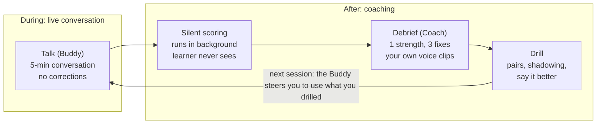

# English Speaking Buddy — Concept, Pen Portraits & User Journeys (Draft)

Nov 6, 2026 · @Khondoker Tanvir Hossain

## 1. Concept draft

**Bolo** (working name; Bangla for "speak") is a voice-first speaking buddy for people who know English on paper but can't speak it with ease. You talk, it scores you silently, and then a coach fixes your top three issues using your own sentences.

### Problem

Many Bangladeshi graduates and professionals have studied English for 12+ years. They read and write it competently, yet freeze in live conversation. Three gaps hold them back:

- **Pronunciation shaped by Bangla sounds.** v becomes bh ("bhery"), z becomes j ("jero"), s and sh swap, an extra vowel goes before s-clusters ("ischool"), th becomes t or d, and speech has flat stress and intonation.
- **Sentence building under pressure.** They speak in short lines translated word for word from Bangla, with few linking words, and default to stock phrases ("I am agree", "kindly do the needful").
- **No safe practice partner.** Friends tease, tutors are expensive and need booking, and apps drill vocabulary instead of conversation.

### Key insight

The barrier is not knowledge. It is **retrieval under pressure plus fear of being judged**. Correcting someone mid-sentence raises the fear, but never correcting them means they don't improve. Bolo separates the two in time: talk freely now, learn afterwards.

### The idea: two characters, one loop

|  | Buddy | Coach |
| --- | --- | --- |
| Job | Keeps you talking, longer and deeper | Makes you better, one fix at a time |
| When | During the conversation | After the conversation |
| Never | Corrects you mid-flow | Gives more than 3 fixes per session |
| Feels like | A curious friend who never laughs at you | A warm, precise teacher who has your recordings |

The loop is **Talk → Silent scoring → Debrief → Drill → Talk again**. In the next conversation, the Buddy steers you into using what you just drilled.

The Buddy owns only the live conversation. Scoring, debrief and drill all happen after it, and each new session loops back to reuse what was drilled.

### How might we

- HMW make speaking practice feel as safe as talking to a friend who never laughs?
- HMW turn a learner's own clumsy sentence into their best lesson?
- HMW help people hear sounds they can't tell they are getting wrong?
- HMW make 7 minutes a day produce change the learner can feel within 3 weeks?
- HMW rehearse the real moment (interview, client call, viva) before it happens?

### Positioning (draft)

For Bangladeshi students and professionals who understand English but freeze when speaking, Bolo is a private AI speaking buddy. It lets you talk freely, then coaches you on your own mistakes. Unlike vocabulary apps or booked tutors, it puts conversation first, is available any time, and is tuned to how Bangla speakers sound.

## 2. Design principles

When two options compete, pick the one that keeps the learner talking without fear.

1. **Talk first, judge later.** Never correct during the conversation. All judgement happens silently and shows up only in the debrief.
2. **Your words are the curriculum.** Every lesson starts from something the learner actually said, never from a textbook sentence.
3. **Three fixes, not thirty.** The debrief shows the 3 issues with the highest impact. Everything else waits for another day.
4. **Hear it, don't read it.** Feedback is audio first: your clip, then the model clip, back to back.
5. **Push for more, gently.** The Buddy's job is to make the learner's turns longer ("why?", "what happened next?", "give me an example").
6. **Progress you can feel.** Prove change with the learner's own voice (Day 1 vs Day 21), not just with scores.
7. **Private by default.** No audience, no public voice leaderboard, no one hears you unless you choose to share.
8. **Short and daily beats long and rare.** Sessions run 5–10 minutes, short enough for a commute or a lunch break.
9. **Rehearse the real moment.** Practice scenarios match the learner's actual goal: an interview, a client call, a viva, an exam.

## 3. Pen portraits

Rafi is the primary persona: the MVP is designed for him first. The other three test whether the same loop stretches to exams, seniority and a specialist field. All four are hypotheses to validate in interviews.

| Persona | Age | Role | Real moment they fear | Priority |
| --- | --- | --- | --- | --- |
| Rafi Ahmed | 27 | Software engineer, Dhaka | Daily standup with a foreign client | Primary |
| Nusrat Jahan | 22 | Final-year BBA student | IELTS Speaking and job viva | Secondary |
| Kamrul Hasan | 36 | Bank relationship manager | Presenting to regional leadership | Secondary |
| Dr. Farhana Islam | 29 | Medical officer | OET role-play with a "patient" | Niche to test |

### Rafi Ahmed — "I know the answer. It just comes out wrong."

Rafi is a 27-year-old backend engineer at a Dhaka software house. He reads documentation all day and writes clean Slack messages and PR comments. Six months ago his team took on an Australian client, and every morning's 15-minute standup is now his worst moment of the day. He rehearses his update in his head, then delivers it in short bursts, ending with "actually" or "that's it". Twice the client asked him to repeat himself. He now keeps his camera off and lets his team lead speak.

- **Goals:** speak confidently in standups and demos, and pass a remote-job interview within a year.
- **Frustrations:** spoken English classes are aimed at beginners, YouTube is passive, and friends joke when he "tries to sound foreign".
- **Speaking profile:** v→bh ("bhery"), z→j ("jero"), th→t ("tree" for three); 2–3 second pauses while he translates; overuses "actually"; answers in 1–2 sentences.
- **Context:** Android phone and earbuds, a 40-minute commute by bus or ride-share, practice at night after 10 pm. He is comfortable with tech and pays for tools that help his career.
- **Success looks like:** he gives his standup update with the camera on and the client never says "sorry, come again?"

### Nusrat Jahan — "In Part 2 I run out of words after 40 seconds."

Nusrat is 22 and in her final year of a BBA at a private university. Her written English is strong; her essays get top marks. She needs IELTS band 7 for a master's abroad and is also applying to management-trainee programmes with English vivas. She lives in a shared hostel room, so she practises in whispers or in the bathroom. A coaching centre gave her a 10-minute mock with a tired examiner who said "good, but expand more" without showing her how.

- **Goals:** IELTS Speaking 7.0, and get through the MTO viva.
- **Frustrations:** no privacy to speak aloud, coaching feedback is vague, and mock tests are rare and expensive.
- **Speaking profile:** s/sh swap ("sort" for short), "ischool" and "istation", flat intonation, can't sustain a 2-minute answer, limited range of linking words.
- **Context:** budget-sensitive, uses her phone with mobile data, studies in bursts before exams, and is motivated by a score and a countdown.
- **Success looks like:** she speaks for the full 2 minutes without panic, and her mock band score climbs from 6.0 to 7.0.

### Kamrul Hasan — "I can't sit in a class with my juniors."

Kamrul is 36, a relationship manager at a private commercial bank. His English vocabulary is large but formal, learned from letters and circulars. He now presents quarterly numbers to a regional team that includes expatriates. He speaks slowly, translates in his head and uses phrases like "kindly do the needful" and "I am having a query". He would never let colleagues see him taking an English course.

- **Goals:** lead meetings and presentations in English, and look promotion-ready.
- **Frustrations:** status and embarrassment, no time for fixed class schedules, and generic courses that teach him things he already knows.
- **Speaking profile:** slow speech rate, many fillers ("umm", "basically"), dated formal phrasing, Bangla stress patterns, and weak stress on key words when presenting.
- **Context:** practises in his car or private cabin, has a 10-minute window before work, values discretion above everything, and is willing to pay.
- **Success looks like:** he presents his quarterly slides without notes, and a senior colleague compliments the presentation.

### Dr. Farhana Islam — "My medicine is fine. My English role-play isn't."

Farhana is a 29-year-old medical officer at a district hospital who plans to move to the UK. She needs OET for registration. She knows clinical English well but struggles with patient-friendly, empathetic spoken language under time pressure. She works night shifts, so her study time is irregular.

- **Goals:** pass the OET Speaking role-plays and sound warm and clear to patients.
- **Frustrations:** irregular hours make booked tutors impractical, and general English apps don't cover clinical scenarios.
- **Speaking profile:** speaks fast when nervous, uses jargon instead of lay terms, and has the same v/bh and z/j substitutions.
- **Context:** studies at 2 am on breaks or post-shift, and needs sessions she can pause and resume.
- **Success looks like:** she explains a diagnosis to a role-play "patient" in plain, warm English and passes OET.

### Who it is not for (anti-persona)

Absolute beginners who can't yet form a basic English sentence, and children under 13. They need structured grammar and vocabulary teaching first, and free-flowing conversation would only overwhelm them.

## 4. User journeys with stories

Rafi's journey runs end to end, from the trigger to the real-world win and the plateau after it. The other three journeys cover only the moments where their needs differ from his.

### Rafi: from "sorry, come again?" to camera on (21 days)

1. **Trigger (Day 0, morning).** At standup the client asks Rafi to repeat himself twice. He mutes himself, his face hot, and lets his team lead finish. On the bus home he thinks, "I write better English than half of them. Why can't I say it?"
2. **Discover (Day 0, night).** A colleague shares a short reel: a before/after clip of someone's spoken English after three weeks on Bolo. Rafi installs it at 11 pm, mostly out of curiosity.
3. **Onboard (60 seconds).** Bolo asks three questions by voice: what he needs English for (*work meetings*), the situation he fears (*standups with an Australian client*), and how much time he has (*10 minutes*). It then asks him to introduce himself for 30 seconds. That recording is saved as his Day 1 clip; he doesn't know yet how much it will matter.
4. **First conversation with the Buddy (5 minutes).** The Buddy, Bolo, asks what he worked on today. Rafi says, "I fix one bug." Bolo asks, "Oh nice, what was it doing?" Rafi explains the payment bug and talks for 40 seconds without noticing. Bolo never corrects him, only asks "why" and "then what". When the timer ends, Bolo says, "I want to hear how the fix goes tomorrow."
5. **Silent scoring (10 seconds).** A short screen reads "Your coach is listening back." Behind it, every turn is scored for pronunciation, fluency, sentence building and vocabulary, and the top 3 issues are chosen.
6. **Debrief with the Coach (2 minutes).** The Coach opens with one thing he did well: "You explained a technical problem clearly for 40 seconds." Then come three fixes:
    1. *The v sound:* his clip "bhery important" plays, then the model "very important", then a 5-second mouth tip (top teeth on the lower lip).
    2. *Upgrade your own sentence:* "Yesterday I fix bug, it was in payment" becomes "Yesterday I fixed a bug in the payment service that was causing failed checkouts."
    3. *Filler watch:* he said "actually" 11 times, and each one is marked on a timeline of the conversation.
7. **Drill (3 minutes).** He works through minimal pairs (*vest/best, very/berry, vote/boat*), repeats the upgraded sentence right after the model voice, then records it again himself. The Coach shows the v sound going from red to amber. Rafi grins at his phone on a dark street.
8. **Return (Day 2, commute time).** A notification arrives: "Bolo wants to know if the payment fix went live." In this conversation Bolo asks questions that pull v-words out of him ("What was the most *valuable* part of the review?") without saying why.
9. **Habit forms (Days 3–9).** His streak builds on the bus. The Coach's report starts naming patterns across sessions: "You've dropped 'actually' from 11 to 4. Articles are your next focus."
10. **Rehearse the real moment (Day 10).** He unlocks *Standup Rehearsal*. The Buddy now plays a brisk client who interrupts: "Sorry, what's the ETA on that?" Rafi practises answering clearly under interruption, three mornings in a row before the real standup.
11. **The real moment (Day 21).** He turns his camera on and gives his update in four full sentences. The client replies, "Great, thanks Rafi," and doesn't ask him to repeat anything. That night Bolo plays his Day 1 and Day 21 introductions side by side. He sends the clip to his wife.
12. **Plateau risk (Day 30+).** The novelty fades and he skips 3 days. Bolo doesn't guilt-trip him. It offers a new goal, *Remote Job Interview Prep*, with a new Buddy who plays a hiring manager. The loop restarts around a bigger ambition.

### Nusrat: the 2-minute wall

- **Privacy problem.** She can't talk aloud in her hostel room, so she uses Bolo at 7 am on the rooftop. Sessions must be useful in 5 minutes and work on a weak mobile-data connection.
- **Exam mode.** She chooses *IELTS Speaking*. The Buddy becomes an examiner who follows the real Part 1/2/3 structure, and a cue card appears with a visible 1-minute preparation timer.
- **The breakthrough debrief.** The Coach shows her answer as a timeline: she stopped at 0:42. It then gives her a 4-part structure (story, detail, feeling, lesson) using her own topic, "a teacher who influenced you". She retries and reaches 1:50.
- **Score motivation.** Each mock ends with an *estimated* band per criterion, clearly labelled as an estimate. Seeing her score rise from 6.0 to 6.5 to 7.0 over 4 weeks keeps her going until exam day.

### Kamrul: discretion first

- **Discreet setup.** He signs up with a personal email. The app icon and notifications are neutral ("Your session is ready") so nothing looks like a "spoken English course" on his screen during meetings.
- **Car mode.** Practice is hands-free and voice-only during a 15-minute drive: no screen needed, and the debrief is read aloud.
- **Presentation rehearsal.** He pastes the talking points for his quarterly review. The Buddy plays a regional head who asks follow-up questions. The Coach flags his pace (too slow), stock phrases ("kindly do the needful" → "could you please handle this?") and weak stress on the key numbers.
- **Payoff.** After the real presentation, a regional colleague says it was the clearest update of the quarter. Kamrul renews his annual plan without hesitation.

### Dr. Farhana: practice that fits a night shift

- **Pause and resume.** A ward call interrupts her at 2:10 am. When she returns 40 minutes later, the session resumes at the same point in the role-play.
- **Role-play scenario.** The Buddy plays an anxious patient's daughter asking about a new diabetes diagnosis. Farhana has to explain it, reassure her and check she has understood.
- **Specialist feedback.** Alongside the pronunciation fixes, the Coach flags jargon ("glycaemic control" → "keeping your sugar levels steady") and marks where she missed a chance to show empathy.
- **Payoff.** She walks into the OET Speaking test having done 30 role-plays, and the first scenario feels familiar.

## 5. Journey map (primary persona)

The journey is most fragile in two places: the first 60 seconds of talking, and the first debrief. If the learner feels judged in the first, or misheard in the second, they don't come back.

| Stage | Doing | Thinking & feeling | Pain point | Opportunity |
| --- | --- | --- | --- | --- |
| Trigger | Fumbles a real conversation | Ashamed, "why can't I say it?" | Moment passes; shame fades into avoidance | Marketing that names the exact feeling |
| Discover | Sees a before/after clip | Curious, sceptical | Apps that promise fluency and drill vocabulary instead | Real voice before/after as proof |
| Onboard | Answers 3 voice questions, records 30-second intro | "Will this be another beginner course?" | Long sign-up forms, placement tests | Voice-first setup in 60 s; goal-specific from the start |
| First conversation | Talks to the Buddy | Nervous, then surprised at how long he talked | Fear of being judged, awkward AI pauses | No corrections, warm follow-ups, fast replies |
| Silent scoring | Waits | "Was I bad?" | Black-box judgement | Short, calm wait screen; open with one strength |
| Debrief | Listens to 3 fixes with his own clips | Exposed, then "oh, I never noticed that" | Feedback overload, misheard words | Max 3 fixes, own-voice clips, option to say "that's not what I said" |
| Drill | Repeats pairs and upgraded sentences | Effortful, small wins | Boring repetition | Instant visual change from red to green; under 3 min |
| Return | Opens at commute time | "Just 5 minutes" | Forgetting, low motivation | Buddy continues yesterday's story, so there's a reason to return |
| Rehearse | Practises the real scenario | Anxious but prepared | Generic scenarios feel fake | Scenario built from his real context |
| Real moment | Speaks at work | Proud, relieved | No way to see progress | Day 1 vs Day 21 voice comparison, shareable |
| Plateau | Skips days | Bored, "good enough" | Guilt-driven streak notifications | New goal, new Buddy persona, no guilt |

## 6. Moments of truth and riskiest assumptions

The riskiest assumption is that automated scoring can hear Bangla-accented speech accurately enough to be trusted. Test that before building anything else.

### Moments of truth

1. **The first 60 seconds of talking.** The learner either feels safe or feels tested.
2. **The first debrief.** If the Coach mishears one word, trust collapses; if it plays back a sound they never noticed, they're hooked.
3. **Day 3 return.** This is the first day the novelty is gone, and the Buddy's continuing story has to pull them back.
4. **The first real-world win.** This turns a user into a paying, recommending user.

### Riskiest assumptions

| # | Assumption | Why it's risky | Cheapest test |
| --- | --- | --- | --- |
| 1 | Pronunciation scoring is accurate on Bangla-accented speech | False flags destroy trust in the Coach | Record 20 speakers; compare automated scores with a human ESL teacher's marks |
| 2 | Learners prefer delayed correction to live correction | Some may want instant fixes | A/B test the two modes with 10 users each; compare return rate and self-rated confidence |
| 3 | 5–10 minute daily sessions are enough to feel progress in 3 weeks | If progress isn't felt, users churn | A 3-week concierge pilot with 10 users; Day 1 vs Day 21 clips rated blind |
| 4 | Voice AI response time feels natural on Bangladeshi mobile networks | Lag makes conversation awkward and raises anxiety | Measure round-trip latency on 4G in Dhaka and outside it |
| 5 | Learners will speak aloud despite privacy limits | Hostels, shared homes and offices | Interviews plus usage-time data; test a headphones-and-murmur mode |
| 6 | Professionals will pay for this; students only if it's cheap | Defines the business model | Fake-door pricing page with 2 tiers; pre-orders from the pilot |
| 7 | Teaching from the learner's own sentences beats a fixed curriculum | Core differentiator | Compare drill completion: own-sentence drills vs generic drills |

### Open questions

- Should the Buddy and the Coach be two visible characters, or one character with two modes?
- Do we need a human-review tier (a teacher checks the AI's feedback weekly) for credibility?
- English only in the UI, or Bangla explanations for the Coach's tips?

## 7. Inputs carried into the PRD

The PRD should build the MVP around Rafi and the core loop, and leave exam, presentation and clinical modes for later releases.

- **Primary persona:** working professionals (Rafi); students (Nusrat) are the second wave.
- **MVP candidates:** voice onboarding with a Day 1 clip, one Buddy, free conversation plus 1 work scenario, silent scoring, a 3-fix debrief with own-voice clips, 3 drill types (minimal pairs, shadowing, "say it better"), and a Day 1 vs Day N comparison.
- **Later:** exam mode, presentation rehearsal, car/hands-free mode, clinical role-plays, multiple Buddy personas, a human-review tier.
- **North-star candidates:** weekly speaking minutes per active learner; % of learners whose fluency score improves by Day 21.
- **Must decide in the PRD:** the speech and pronunciation-scoring stack, Bangla in the UI or not, pricing tiers, and the privacy/data-retention policy for voice recordings.
