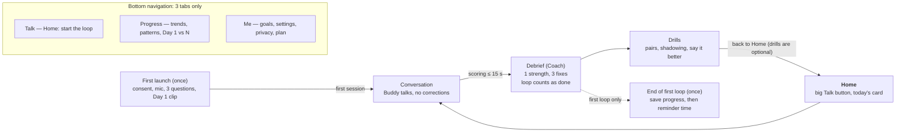
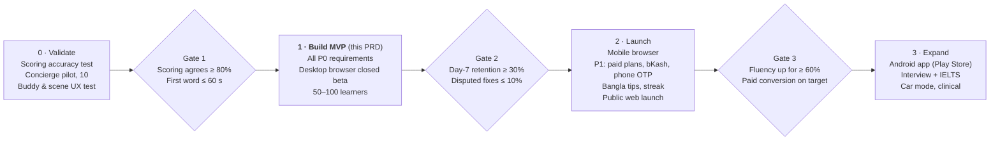

# Bolo — Product Requirements Document (MVP)

Nov 6, 2026 · updated Nov 7, 2026 for browser-first · @Khondoker Tanvir Hossain

## 1. Overview

The Bolo MVP is a browser-first app for Bangla-speaking professionals. It ships in three steps: desktop browser (closed beta), then mobile browser (public launch), then an Android app. The architecture is in [Bolo-Architecture-MVP.md](Bolo-Architecture-MVP.md). It runs one daily loop: 5 or 10 minutes of talking with a Buddy who sits beside the learner, then a 2-minute debrief with 3 fixes from a Coach, then optional 3-minute drills. This PRD defines what the MVP must do, how each feature behaves in every case, and how we will know it works. It builds on the [concept, pen portraits and journeys doc](https://claude.ai/artifact/G3eA6oVoBY353c7Bxe1r2P).

### Problem

Learners who already read and write English freeze when they speak. Their pronunciation carries Bangla sound patterns, they build short translated sentences under pressure, and they have no safe partner to practise with. Existing options either correct them mid-sentence, which raises their fear, or teach vocabulary they already know.

### Goals (MVP)

1. **Safe practice:** a learner can speak English for 5 minutes without being interrupted or corrected.
2. **Precise feedback:** after every session, the learner gets the 3 most useful fixes, built from their own voice and sentences.
3. **Felt progress:** within 21 days, the learner can hear and see their own improvement.
4. **Simplicity:** a first-time learner speaks within 60 seconds of opening the app and is in a real conversation within 3 minutes, without typing or reading instructions.

### Non-goals (MVP)

- Teaching English from zero (grammar lessons, vocabulary courses)
- Live human tutors or a marketplace
- Social features, public leaderboards, sharing feeds
- Exam certification or official band scores
- Native iOS app (iPhone users get the mobile browser version), and any paywall in the closed beta (paid plans arrive at public launch)

### Success metrics

Targets are proposals to confirm after the validation phase (section 11). A loop is complete once the learner has talked and heard the debrief; drills are optional and never affect loop counts or streaks.

| Metric | Definition | MVP target |
| --- | --- | --- |
| North star: weekly completed loops | Loops (talk + debrief) per weekly active learner | ≥ 3 |
| Time to first word | First app open → first spoken answer to Bolo (an onboarding answer counts) | ≤ 60 s median; first conversation turn ≤ 3 min |
| Day-7 retention | % of new learners who complete a loop on day 6–8 | ≥ 30% |
| Fluency improvement | % of learners with ≥ 5 loops whose fluency score rises from Day 1 to Day 21 | ≥ 60% |
| Feedback trust | % of debrief fixes *not* disputed as "that's not what I said" | ≥ 90% |
| Debrief completion | % of sessions where the learner hears all 3 fixes | ≥ 80% |
| Session satisfaction | Post-session rating of 4–5 out of 5 | ≥ 70% |

## 2. Users and scope

The MVP serves one persona well: a working professional who writes English comfortably but freezes when speaking at work. Students, exam-takers and specialist fields come in later releases.

**Primary user (MVP).** Rafi: 22–40, a Bangladeshi graduate working in tech, banking, pharma or a multinational. Uses a laptop at work and an Android phone with earbuds, practises at a desk, during a commute or late at night, and has a real work moment he fears (standups, client calls, interviews).

**Secondary users (v1.1+).** Exam-takers (IELTS, OET), senior professionals who need discretion, and clinicians preparing role-plays.

**Out of scope.** Absolute beginners and children under 13.

### MVP scope

| Area | In the MVP | Later |
| --- | --- | --- |
| Platform | Desktop browser (closed beta), then mobile browser as an installable web app (public launch); English UI with Bangla helper text | Android app (Play Store wrapper of the web app first), native iOS |
| Onboarding | Voice-first: consent, mic, 3 questions, 30-second Day 1 clip; account after the first loop | Placement test |
| Buddy | 1 Buddy persona; free talk + daily topic | Multiple personas, learner chooses voice/accent |
| Scenarios | Free talk, Standup Rehearsal | Job interview, IELTS, presentation, clinical role-play |
| Assessment | Pronunciation (Bangla-specific sounds), fluency, sentence building, vocabulary | Intonation and stress detail, band estimates |
| Coach debrief | 1 strength + max 3 fixes, own-voice clips, dispute a fix | Weekly human-teacher review |
| Drills | Minimal pairs, shadowing, say it better | Spaced review, pronunciation games |
| Progress | Day 1 vs Day N clip, 4 skill trends, personal error profile | Certificates, shareable report |
| Habit | Daily reminder at a chosen time, Buddy story continuity, gentle streak | Weekly goals, friend challenges |
| Plans | None: the closed beta is free | Free (7 talks in the first week, then 2 a month) plus Basic, Premium and Ultimate monthly plans (bKash, card), and a first-year invite offer, at public launch; family, team and B2B plans later |
| Modes | Side-by-side companion in 2 scenes (hilltop, drive); voice-only mode | More scenes, realistic rehearsal avatar, car mode, offline drills |

## 3. UX and simplicity rules

Every screen must pass all 12 rules below before it ships. They are written to be testable in design review and in QA.

| # | Rule | How we test it |
| --- | --- | --- |
| R1 | **One primary action per screen.** Other actions are visually secondary. | Design review: only one filled button per screen; Home follows the priority table (US-6.9) |
| R2 | **Talk is always one tap away.** From Home, a single tap starts a conversation. | Tap count from Home to the first Buddy line = 1 |
| R3 | **No typing in the core loop.** Onboarding, talk, debrief and drill are fully voice- and tap-driven. | No text input fields in these flows |
| R4 | **Speaking within 60 seconds of first launch; first conversation within 3 minutes.** | Median time to first word and to first conversation turn, 10 usability testers |
| R5 | **Max 3 of anything.** 3 fixes per debrief (scenario fixes included), 3 drills per session, 3 bottom tabs. | Content and layout audit |
| R6 | **Plain words, no linguistics jargon.** Write "the v sound", not "labiodental fricative" or "phoneme". | Copy review against a banned-word list |
| R7 | **Never a dead end.** Every error or empty state offers exactly one clear next action. | Edge-case matrix in section 7 fully covered |
| R8 | **Audio before text.** Feedback plays sound first; text is the backup. | Every fix card has a play button as its first element |
| R9 | **Kind tone.** Open every debrief with a strength; never use "wrong", "bad" or "error" in learner-facing copy. | Copy review |
| R10 | **Low-end friendly.** Works smoothly on an office laptop on a slow connection, and (from the mobile browser release) on a 2 GB RAM Android phone on 3G. | Device lab test: no screen takes > 2 s to become usable |
| R11 | **One-handed use on phones, keyboard on computers.** On phones, primary actions sit in the bottom third of the screen; on computers, every action has a key (see the design system's desktop page). | Thumb-zone overlay and keyboard-only walkthrough in design review |
| R12 | **Interrupt-safe.** Leaving the app at any point loses nothing; the learner resumes where they were. | Close the tab, switch tabs and drop the network at every step in QA and confirm it resumes |

### Navigation model

Three bottom tabs only: **Talk** (Home), **Progress** and **Me** (settings, plan, privacy). There are no hamburger menus or nested settings deeper than 2 levels.

### Voice and tone

- **Buddy:** casual, curious, short sentences, asks one question at a time, never corrects. Sits beside the learner and looks ahead while talking (E9 Presence). The Buddy is called **Bolo**, the same as the app. The Coach is a separate character with its own voice (name to be chosen).
- **Coach:** warm, specific, brief. Each fix follows the pattern *"Here's what you said → here's the better way → try it."*
- **App copy:** second person, active voice, sentences under 12 words. Bangla helper text appears under English only on onboarding and error screens.

### Design inputs

- **Targets:** desktop at 1280px and up first (layouts down to 1024px and 640px are in the design system); phone at 360 px wide first, then 412 px.
- **Screen inventory:** design produces it from the app map (section 4) and the stories (section 6) as the first design deliverable.
- **Banned words (R6, R9), starter list:** wrong, bad, error, mistake, fail, incorrect, poor, phoneme, schwa, fricative, labiodental. Never describe an accent as a problem.
- **Bangla copy:** written by a native Bangla copywriter and reviewed by 3 target users; never machine-translated alone.
- **Mouth-position illustrations:** one simple illustration for each of the 6 target sounds in ASM-2.
- **Buddy brief:** personality, voice and visual direction come from E9 Presence; design prototypes one character and two characters (Buddy + Coach) for the Phase 0 test.

## 4. App map

The MVP has 4 core screens in one loop, 2 one-time moments (dashed) and 3 bottom tabs.

The first session runs straight from onboarding into a conversation; after that, every session starts from the Talk button on Home. A loop counts as done once the debrief is heard; drills are optional, and the learner returns to Home either way.

## 5. Functional requirements

The MVP has 77 functional requirements across 11 modules. **P0** is required for the closed beta (Phase 1), **P1** is required for public launch (Phase 2), and **P2** is planned later. Each requirement is covered by the user stories in section 6.

### 5.1 Onboarding (ONB)

| ID | Requirement | Priority |
| --- | --- | --- |
| ONB-1 | Launch straight into a voice welcome; no sign-up before the first conversation. | P0 |
| ONB-7 | Before the mic prompt, show one consent screen: an explicit choice to keep recordings or not (nothing pre-selected), plus an "I'm 13 or older" confirmation. | P0 |
| ONB-2 | Request microphone permission with a one-line reason shown before the system prompt. | P0 |
| ONB-3 | Ask 3 setup questions by voice with tap-able answer chips: goal, feared situation, daily talk time (5 or 10 minutes of talking). | P0 |
| ONB-4 | Record a 30-second self-introduction as the Day 1 clip; keep it on the device until sign-in, and upload it only if the learner chose to keep recordings. | P0 |
| ONB-5 | Run a 5-second mic check (volume and background noise) and coach the learner if the level is poor. | P0 |
| ONB-6 | Offer Bangla helper text under onboarding screens (toggle, on by default). | P1 |

### 5.2 Conversation with the Buddy (TLK)

| ID | Requirement | Priority |
| --- | --- | --- |
| TLK-1 | Start a conversation with one tap from Home. | P0 |
| TLK-2 | The Buddy speaks first, asks one open question at a time and follows up on the learner's answer. | P0 |
| TLK-3 | The Buddy never corrects pronunciation or grammar during the conversation. | P0 |
| TLK-4 | End the learner's turn adaptively: wait at least 2.5 s of silence, and longer when the sentence sounds unfinished; a "Done" tap ends the turn at once. | P0 |
| TLK-5 | Prompt for longer answers when a turn is under about 5 words ("Tell me more", "Why?", "Give an example"). | P0 |
| TLK-6 | Gently re-prompt after 8 s of silence; offer a hint after 15 s. | P0 |
| TLK-7 | If the learner speaks Bangla, the Buddy acknowledges it kindly and asks them to try in English, offering a starter phrase. | P0 |
| TLK-8 | **Changed 2026-11-12 (founder):** the talk is shown as a live chat in the sky above the companion. The Buddy's turns appear word by word as it speaks; the learner's own words appear live while they speak (exactly as recognised) and settle into their bubble when the turn ends; earlier turns stay and the chat scrolls itself. A **Talk view** setting keeps the earlier style (Buddy caption only, learner's words not shown) for anyone who prefers it. *Was: a live caption of the Buddy's lines only; the learner's own words not shown live.* | P0 |
| TLK-9 | End the session naturally when the chosen talk time (5 or 10 minutes) is reached; allow early end at any time. | P0 |
| TLK-10 | Pause and resume within 30 minutes without losing the conversation. | P0 |
| TLK-11 | Remember the previous session's topic and open the next session with a follow-up about it. | P0 |
| TLK-12 | Steer the conversation to elicit the learner's current focus sounds and patterns. | P1 |
| TLK-13 | Let the learner ask the Buddy to repeat or slow down ("Sorry?", "Slower please"). | P0 |
| TLK-14 | Keep conversations safe: refuse harmful topics and redirect politely; crisis responses use approved local helpline content. | P0 |
| TLK-15 | Barge-in (learner speaking over the Buddy stops it) works only when the learner says they use headphones (asked once in the mic picker, since a browser can't detect them); it is off otherwise, and switches off automatically if the Buddy's voice is heard in the mic. | P0 |
| TLK-16 | **Changed 2026-11-12 (founder):** the conversation screen shows the companion scene (unchanged), the chat (TLK-8), a countdown of the time left in numbers ("3:42 left", turning to a gentle "1 minute left" near the end), a mic level meter that moves with the learner's voice, Pause, Done and End. The Talk view setting's earlier style keeps the subtle time-remaining arc with no numbers. *Was: only the scene, the mic state, the Buddy's caption, a subtle time-remaining arc, Pause and End.* | P0 |

### 5.3 Silent assessment (ASM)

| ID | Requirement | Priority |
| --- | --- | --- |
| ASM-1 | Score every learner turn on 4 skills: pronunciation, fluency, sentence building and vocabulary. | P0 |
| ASM-2 | Detect Bangla-speaker sound patterns at minimum: v/bh, z/j, s/sh, th/t-d, w/v, extra vowel before s-clusters. | P0 |
| ASM-3 | Measure fluency: words per minute, pauses longer than 1.2 s inside a turn, and filler words. | P0 |
| ASM-4 | Choose the 3 highest-impact issues per session (by frequency × how much it hurts understanding). In scenarios, the scenario fix replaces the lowest-ranked of the 3. | P0 |
| ASM-5 | Attach a confidence level to each issue; never surface an issue below the confidence threshold. | P0 |
| ASM-6 | If there isn't enough speech (< 60 s total), skip scoring and say so kindly. | P0 |
| ASM-7 | Have the debrief ready within 15 s of the session ending. | P0 |

### 5.4 Debrief with the Coach (DBF)

| ID | Requirement | Priority |
| --- | --- | --- |
| DBF-1 | Open with one specific strength from this session. | P0 |
| DBF-2 | Show at most 3 fix cards, one at a time, each with: the learner's clip, the model version, a 1-line tip and a "Try it" action. | P0 |
| DBF-3 | Fix types: sound fix, sentence upgrade ("say it better") and habit fix (fillers, pauses, very short answers). | P0 |
| DBF-4 | Let the learner dispute a fix ("That's not what I said"); remove it and log it for quality review. | P0 |
| DBF-5 | Show the session's 4 skill scores as simple levels (Building / Good / Strong), not raw numbers. | P0 |
| DBF-6 | Let the learner view the full transcript of the session, with fixed spots highlighted. | P1 |
| DBF-7 | Offer a Bangla explanation for any tip (tap "বাংলায়"). | P1 |
| DBF-8 | Ask for a session rating after sessions 2, 3 and 4, then every 3rd session; never after session 1. | P0 |

### 5.5 Drills (DRL)

| ID | Requirement | Priority |
| --- | --- | --- |
| DRL-1 | Generate up to 3 drills from this session's fixes. | P0 |
| DRL-2 | Minimal pairs: hear and say word pairs for the target sound, with instant pass/retry feedback. | P0 |
| DRL-3 | Shadowing: repeat the model sentence straight after hearing it, then hear both versions. | P0 |
| DRL-4 | Say it better: re-say your own upgraded sentence and see the improvement. | P0 |
| DRL-5 | Allow skip at any point; skipped drills return in the next session. | P0 |
| DRL-6 | Limit attempts to 3 per item, then move on with encouragement. | P0 |
| DRL-7 | End drills with a summary of what improved today and a single "Done" button. Drills are optional and never affect loop completion. | P0 |

### 5.6 Progress and habit (PRG)

| ID | Requirement | Priority |
| --- | --- | --- |
| PRG-1 | Show 4 skill trends over time. | P0 |
| PRG-2 | Play the Day 1 clip side by side with a fresh recording of the same intro, unlocked at Day 7, 14, 21 and every 30 days after. | P0 |
| PRG-3 | Show a personal error profile: the learner's top patterns, each marked improving, steady or new. | P0 |
| PRG-4 | Track a gentle streak that allows 1 rest day per week without breaking it. | P1 |
| PRG-5 | Send a daily reminder at the learner's chosen time, with a Buddy-story hook. Maximum 1 per day. On the free plan after the first week, remind only when free talks are available. | P0 |
| PRG-6 | Stop reminders after 3 ignored in a row; send one "we're here when you're ready" message after 7 days. | P0 |
| PRG-7 | End the first loop in a fixed order: drills offer → save progress → reminder time with notification permission. No rating in session 1. | P0 |
| PRG-8 | History lists past sessions newest first, each with date, topic and its fixes. | P0 |

### 5.7 Scenarios (SCN)

| ID | Requirement | Priority |
| --- | --- | --- |
| SCN-1 | Offer Free Talk (default) and Standup Rehearsal in the MVP; both are free in the closed beta. | P0 |
| SCN-2 | In Standup Rehearsal, the Buddy plays a client or manager, asks for an update and interrupts with follow-ups. | P0 |
| SCN-3 | Let the learner set the context in one line by voice ("I'm a backend dev on a payments team"). | P1 |

### 5.8 Account, privacy and plans (ACC)

| ID | Requirement | Priority |
| --- | --- | --- |
| ACC-1 | Prompt for an account at the end of the first loop (PRG-7), to save progress. Google sign-in in the closed beta (P0); phone OTP is added at public launch (P1). | P0 |
| ACC-2 | Allow continuing as a guest for up to 3 sessions. Guest sessions are scored on the server; recordings are kept only if the learner chose to keep them (ONB-7). | P0 |
| ACC-3 | Store the consent choice from ONB-7 with time and policy version; the learner can change it any time in Me → Privacy. | P0 |
| ACC-4 | Delete any single recording, or all data, from Me → Privacy; complete deletion within 7 days. | P0 |
| ACC-5 | Free plan: 7 talks in the first 7 days (counted from the first talk), then 2 talks a month, for everyone (a talk is one 5-minute conversation plus its Coach debrief). Paid monthly plans: Basic ৳300, Premium ৳500, Ultimate ৳1000. Plans differ only in how many talks they include; every plan has every feature, and every plan states its talk limit as a number (set after the cost test). No plan is called "Unlimited". | P1 |
| ACC-6 | Payment via bKash and card; monthly billing; change plan or cancel anytime, cancelling in 2 taps. | P1 |
| ACC-7 | Restore goals, history, patterns and the Day 1 clip on a new device or browser after sign-in. | P0 |
| ACC-8 | In Bolo's first year only: a learner whose 3 invited friends each finish a first talk gets one month of Basic free. Invites are shared by hand through a link; Bolo never reads contacts or sends anything itself. | P1 |

### 5.9 Settings and accessibility (SET)

| ID | Requirement | Priority |
| --- | --- | --- |
| SET-1 | Buddy speaking speed: slower / normal. | P0 |
| SET-2 | Captions on/off; text size follows the system setting. | P0 |
| SET-3 | Light and dark themes following the system. | P1 |
| SET-4 | Data saver: lower audio quality, no auto-play of model audio. | P1 |

### 5.10 Home (HOM)

| ID | Requirement | Priority |
| --- | --- | --- |
| HOM-1 | Home shows one primary button and at most one secondary card, chosen by the priority table in US-6.9. The scenario "Change" link is quiet text under the primary button. | P0 |

### 5.11 Presence (PRS)

| ID | Requirement | Priority |
| --- | --- | --- |
| PRS-1 | Show the Buddy as a companion sitting beside the learner in a scene, seen in profile or partly from behind, never face-on while talking. | P0 |
| PRS-2 | Ship 2 scenes in the MVP: Hilltop at sunset (default) and Evening drive. The learner can switch scenes from the conversation screen or Me → Settings. | P0 |
| PRS-3 | Companion states: idle (breathing), listening (turns slightly, nods), glance (brief look and smile at good moments), speaking (looks ahead), facing (turns to the learner for the debrief). | P0 |
| PRS-4 | Play a quiet ambient soundscape for each scene, lowered automatically under speech. | P0 |
| PRS-5 | With earbuds, place the Buddy's voice slightly to the companion's side in stereo. | P0 |
| PRS-6 | Let the learner choose a companion: male, female or a non-human character. The companion is always framed as a friend, never romantic. | P0 |
| PRS-7 | Offer a voice-only mode (soft pulsing ring), and fall back to a still scene on low-end devices or when "Remove animations" is on. | P0 |
| PRS-8 | Scenes download once, are cached by the browser and are ≤ 3 MB each; the default scene is cached on first visit and works offline. | P0 |

## 6. User stories and acceptance criteria

The 9 epics below cover the happy path and every edge case we can foresee for each step of the loop. Each story lists its priority and the requirements it covers. Acceptance criteria use Given / When / Then and are written to be tested directly by QA.

### 6.1 E1 · Onboarding and first run

**US-1.1 · Start talking without signing up** · P0 · ONB-1

*As a* first-time learner, *I want to* start talking before creating an account, *so that* I see the value before committing.

- **Given** I open the app for the first time, **when** it finishes loading, **then** the Buddy's voice welcome starts within 3 s and no sign-up or login screen appears.
- **Given** the welcome is playing, **when** I tap "Skip intro", **then** I go straight to the first setup question.
- **Given** my phone is on silent, **when** the welcome starts, **then** captions show the welcome and a banner says "Turn up your volume to hear your Buddy."

**US-1.1a · Choose what Bolo keeps, before it listens** · P0 · ONB-7, ACC-3

*As a* new learner, *I want to* decide whether my recordings are kept before I say anything, *so that* I trust the app with my voice.

- **Given** the welcome ends, **when** the consent screen shows, **then** it asks in plain words "Bolo listens only while you practise. Keep your recordings so you can hear your progress later?" with two equal buttons: "Yes, keep them" and "No, just give feedback". Nothing is pre-selected.
- **Given** the consent screen, **when** I haven't ticked "I'm 13 or older", **then** both buttons stay disabled. A quiet "I'm under 13" link shows "Bolo is for ages 13 and up" and stops onboarding.
- **Given** I chose "No", **when** I practise, **then** my audio is used for feedback and deleted within 24 hours, and my Day 1 clip stays only on my phone.
- **Given** I made either choice, **when** onboarding continues, **then** the mic permission screen (US-1.2) follows immediately. The consent step takes under 10 s for most testers.

**US-1.2 · Give microphone access** · P0 · ONB-2

*As a* learner, *I want to* understand why the app needs my microphone, *so that* I feel safe allowing it.

- **Given** I reach the first speaking step, **when** the app needs the mic, **then** a screen first explains "Bolo listens only while you practise" with one button: "Allow microphone".
- **Given** I tap "Allow microphone", **when** the system prompt appears and I allow it, **then** onboarding continues to the next step automatically.

**US-1.3 · Recover from a denied microphone** · P0 · ONB-2 · edge case

*As a* learner who tapped "Deny", *I want* a simple way to fix it, *so that* I'm not stuck.

- **Given** I denied the mic once, **when** I return to the speaking step, **then** I see "Bolo needs your mic to hear you" and a single "Try again" button that shows the system prompt again.
- **Given** the browser has blocked the mic for Bolo, **when** I tap "Try again", **then** I see a picture of where to unblock it (the icon beside the address bar) for my browser.
- **Given** I unblocked the mic, **when** I come back to the tab, **then** it detects the permission and continues from the same step with no extra tap.

**US-1.4 · Tell Bolo my goal** · P0 · ONB-3

*As a* learner, *I want to* say what I need English for, *so that* practice matches my real life.

- **Given** the Buddy asks "What do you need English for most?", **when** I answer by voice, **then** the app matches my answer to one option (Work meetings / Job interviews / Study abroad / Daily confidence) and shows it as selected.
- **Given** my spoken answer doesn't match any option, **when** the app can't classify it, **then** the 4 options appear as tap-able chips with "Or tap one".
- **Given** I've answered all 3 questions, **when** I want to change one, **then** I can tap "Back" on any question without losing other answers.
- **Given** setup is complete, **when** I look at Me → My goals later, **then** all 3 answers are editable there.

**US-1.5 · Check my mic and room** · P0 · ONB-5

*As a* learner, *I want* the app to check it can hear me well, *so that* my feedback is accurate.

- **Given** the mic check runs, **when** my voice level and background noise are fine, **then** I see a green tick and "Sounds great" for 1 s, and onboarding continues.
- **Given** the background is noisy, **when** the check finishes, **then** I see "It's a bit noisy. Earbuds or a quieter spot will help" with "Check again" (primary) and "Continue anyway" (secondary).
- **Given** my voice is too quiet, **when** the check finishes, **then** I see "Speak a little louder or hold the phone closer" and "Check again".
- **Given** I choose "Continue anyway", **when** I later get a debrief, **then** low-confidence issues are hidden (ASM-5) and the debrief notes "Noisy audio, so some feedback was skipped."

**US-1.6 · Record my Day 1 clip** · P0 · ONB-4

*As a* learner, *I want to* record a short introduction now, *so that* I can hear my progress later.

- **Given** the Buddy asks me to introduce myself, **when** I tap the record button, **then** a 30-second ring timer counts down and recording stops automatically at 30 s or when I tap Stop.
- **Given** I spoke for under 10 s, **when** recording stops, **then** I see "Want to say a bit more?" with "Record again" (primary) and "Keep it" (secondary). This prompt appears once only.
- **Given** I'm unhappy with my clip, **when** I tap "Record again", **then** the new clip replaces the old one. I can re-record up to 3 times.
- **Given** the clip is saved, **when** recording finishes, **then** I'm told "Saved. We'll play this back to you on Day 7" and the first conversation starts. As a guest, the clip stays on my phone; it's uploaded only after sign-in, and only if I chose to keep recordings.

**US-1.7 · Resume interrupted onboarding** · P0 · R12 · edge case

*As a* learner who got a call mid-setup, *I want to* pick up where I left off, *so that* I don't repeat steps.

- **Given** I leave the app during any onboarding step, **when** I reopen it within 7 days, **then** it resumes at the same step with earlier answers kept.
- **Given** I was mid-recording when interrupted, **when** I return, **then** the partial recording is discarded and that step restarts.

**US-1.8 · Read helper text in Bangla** · P1 · ONB-6

*As a* learner who reads Bangla faster, *I want* short Bangla helper lines, *so that* I never misunderstand an instruction.

- **Given** helper text is on (default), **when** I see an onboarding or error screen, **then** a one-line Bangla translation appears under the English text in a smaller, lighter style.
- **Given** I switch helper text off in Me → Settings, **when** I see those screens, **then** only English is shown.

**US-1.9 · Start with no internet** · P0 · edge case

*As a* learner on a weak connection, *I want to* know clearly why I can't talk yet, *so that* I don't think the app is broken.

- **Given** I'm offline during onboarding, **when** I answer setup questions and record my Day 1 clip, **then** both work offline and are saved on the device.
- **Given** I'm still offline, **when** the first conversation should start, **then** I see "Your Buddy needs internet to talk" with one button, "Try again", and the app retries automatically once the connection returns.

### 6.2 E2 · Conversation with the Buddy

**US-2.1 · Start a conversation in one tap** · P0 · TLK-1, TLK-2

*As a* learner, *I want to* start talking with one tap, *so that* practice takes no effort to begin.

- **Given** I'm on Home, **when** I tap the large "Talk" button, **then** the Buddy speaks its first line within 2 s.
- **Given** the conversation has started, **when** the Buddy finishes speaking, **then** a pulsing mic ring shows it is my turn. There is no button to hold.
- **Given** it's my first ever conversation, **when** the Buddy opens, **then** it asks about my day or my goal from onboarding, never a test-style question.

**US-2.2 · Be listened to without correction** · P0 · TLK-3

*As a* nervous speaker, *I want* the Buddy never to correct me while I talk, *so that* I keep going.

- **Given** I make any pronunciation or grammar mistake, **when** the Buddy replies, **then** it responds only to my meaning and does not repeat my sentence back in corrected form.
- **Given** the Buddy didn't understand me, **when** it replies, **then** it asks for clarification the way a friend would ("Sorry, did you mean the payment bug or the login bug?"), not as a correction.

**US-2.3 · Natural turn-taking** · P0 · TLK-4

*As a* learner, *I want* the Buddy to know when I've finished, *so that* the conversation flows.

- **Given** I'm speaking, **when** I stay silent for at least 2.5 s (longer if my sentence sounds unfinished), **then** my turn ends and the Buddy replies.
- **Given** I pause mid-thought, **when** I start speaking again before my turn ends, **then** my turn continues uninterrupted.
- **Given** I want to finish my turn early, **when** I tap "Done", **then** the Buddy replies immediately.
- **Given** I start speaking while the Buddy is still talking, **when** my voice is detected, **then** the Buddy stops and listens (barge-in), but only when I told Bolo I'm using headphones. On speakers, the Buddy finishes its line first, because the mic would hear the Buddy's own voice.

**US-2.4 · Get pushed to say more** · P0 · TLK-5

*As a* learner who gives one-line answers, *I want* the Buddy to draw more out of me, *so that* I practise longer sentences.

- **Given** my turn is under about 5 words, **when** the Buddy replies, **then** it asks a specific follow-up about what I said ("Why was it hard?", "What happened next?").
- **Given** I've given 3 short answers in a row, **when** the Buddy replies, **then** it offers a starter ("You could start with: The hardest part was…").
- **Given** I give a long, detailed answer, **when** the Buddy replies, **then** it reacts to a specific detail I mentioned, to show it listened.

**US-2.5 · Help when I go silent** · P0 · TLK-6 · edge case

*As a* learner who freezes, *I want* gentle help, *so that* silence doesn't become embarrassing.

- **Given** it's my turn and I'm silent for 8 s, **when** the timer passes, **then** the Buddy says something encouraging ("Take your time") and repeats the question more simply.
- **Given** I'm silent for 15 s, **when** the timer passes, **then** a hint card appears with 2 sentence starters I can read aloud.
- **Given** I'm silent for 45 s, **when** the timer passes, **then** the session pauses and shows "Paused. Tap to continue."

**US-2.6 · Speaking Bangla by accident** · P0 · TLK-7 · edge case

*As a* learner who switches to Bangla when stuck, *I want* a kind nudge back to English, *so that* I don't feel caught out.

- **Given** I say a full sentence mostly in Bangla, **when** the Buddy replies, **then** it says "I think you said something like \[meaning\]. Can you try that in English?" and shows a starter phrase.
- **Given** I use a single Bangla word in an English sentence, **when** the Buddy replies, **then** it continues normally. The word is noted for the vocabulary score, not challenged.

**US-2.7 · Ask the Buddy to repeat or slow down** · P0 · TLK-13, SET-1

*As a* learner, *I want to* ask the Buddy to repeat itself, *so that* I never miss a question.

- **Given** the Buddy just spoke, **when** I say "Sorry?", "Pardon?" or "Repeat please", or tap the replay icon, **then** it repeats the last line.
- **Given** I say "Slower please", **when** the Buddy next speaks, **then** it uses the slower speed for the rest of the session and asks if I want it as my default.

**US-2.8 · See captions of what the Buddy says** · P0 · TLK-8

*As a* learner, *I want* to read the Buddy's words, *so that* an unfamiliar accent doesn't block me.

- **Given** captions are on (default), **when** the Buddy speaks, **then** its words appear on screen as it speaks.
- **Given** it's my turn and the chat view is on (default), **when** I speak, **then** my own words appear live in my bubble as Bolo hears them, and settle when my turn ends (changed 2026-11-12).
- **Given** I chose the earlier view in Settings → Talk view, **when** I speak, **then** my own words are not shown live, so I focus on speaking rather than reading.

**US-2.9 · End the session** · P0 · TLK-9 · edge case

*As a* learner, *I want* the session to end naturally or when I choose, *so that* it fits my time.

- **Given** my chosen talk time (5 or 10 minutes) is reached, **when** I finish my current turn, **then** the Buddy wraps up warmly with a hook for next time and the debrief loads.
- **Given** I tap "End" early, **when** I confirm on a single sheet ("End and get feedback?"), **then** the debrief loads if I've spoken ≥ 60 s, or I see the "too short" state (US-3.3) if not.
- **Given** I tap "End" by mistake, **when** the sheet appears, **then** "Keep talking" is the primary button.

**US-2.10 · Pause and resume** · P0 · TLK-10, R12 · edge case

*As a* learner who gets interrupted, *I want to* pause and come back, *so that* I don't lose my session.

- **Given** a phone call arrives, or I switch apps or lock the screen, **when** that happens, **then** the session pauses automatically.
- **Given** I return within 30 minutes, **when** I open the app, **then** "Continue your chat" resumes it and the Buddy recaps the last question.
- **Given** I return after 30 minutes, **when** I open the app, **then** the session is closed. If I'd spoken ≥ 60 s, its debrief is waiting for me.

**US-2.11 · Continue yesterday's story** · P0 · TLK-11

*As a* returning learner, *I want* the Buddy to remember what we talked about, *so that* it feels like a real friend.

- **Given** I mentioned an upcoming event last session ("demo on Thursday"), **when** I start my next session, **then** the Buddy's first question follows up on it.
- **Given** I'd rather talk about something new, **when** I say "Let's talk about something else", **then** the Buddy switches topic without comment.

**US-2.12 · Connection drops mid-conversation** · P0 · edge case

*As a* learner on mobile data, *I want* the session to survive a short drop, *so that* I don't lose my practice.

- **Given** my connection drops while I'm speaking, **when** it returns within 20 s, **then** my turn is uploaded and the conversation continues.
- **Given** the Buddy's reply takes over 4 s, **when** waiting, **then** I see "Your Buddy is thinking…" rather than a frozen screen.
- **Given** the connection is lost for over 20 s, **when** that happens, **then** the session pauses with "Connection lost. We saved everything," and turns already spoken still count towards the debrief.

**US-2.13 · Stay safe in conversation** · P0 · TLK-14 · edge case

*As a* learner, *I want* the Buddy to stay respectful, *so that* I always feel safe.

- **Given** I raise a harmful or explicit topic, **when** the Buddy replies, **then** it declines politely and suggests another topic, without a lecture.
- **Given** I mention self-harm or a crisis, **when** the Buddy replies, **then** it responds with care, stops the practice framing and shows local help resources.

**US-2.14 · Get nudged to practise my weak sounds** · P1 · TLK-12

*As a* learner working on a sound, *I want* the Buddy to give me chances to use it, *so that* I practise without noticing.

- **Given** my current focus is the v sound, **when** the Buddy asks questions, **then** at least 2 questions per session naturally invite words with that sound ("What was the most valuable part?"), without saying why.
- **Given** I have no focus pattern yet, **when** the session runs, **then** the Buddy chooses topics freely.

**US-2.15 · See only what I need while talking** · P0 · TLK-16, PRS-1

*As a* nervous speaker, *I want* a calm conversation screen, *so that* nothing distracts me from speaking.

- **Given** a conversation is running in the chat view (default, changed 2026-11-12), **when** I look at the screen, **then** I see the companion scene, the chat in the sky above it, the time left in numbers, a mic level meter, Pause, Done and a small End button. Scores are never shown.
- **Given** it's my turn, **when** I speak, **then** the level meter moves with my voice, so I know Bolo hears me.
- **Given** 1 minute of talk time is left, **when** the countdown reaches it, **then** it gently reads "1 minute left" (no colour change, no sound); the Buddy starts wrapping up naturally.
- **Given** I chose the earlier view in Settings → Talk view, **when** I look at the screen, **then** I see only the scene, the mic ring, the Buddy's caption, a thin time-remaining arc with no numbers, Pause and End, as before.
- **Given** a hint is triggered (US-2.5), **when** it appears, **then** it slides up from the bottom and disappears as soon as I start speaking.

### 6.3 E3 · Silent assessment

The learner never sees this epic directly; it powers the debrief. Its stories are written from the learner's point of view so that QA can test the outcome.

**US-3.1 · Be scored on what matters** · P0 · ASM-1, ASM-3

*As a* learner, *I want* my speaking judged on clear skills, *so that* I know what to work on.

- **Given** I complete a session, **when** scoring runs, **then** each of my turns gets a level for pronunciation, fluency, sentence building and vocabulary.
- **Given** fluency is scored, **when** the debrief shows it, **then** it's based on words per minute, number and length of long pauses (> 1.2 s inside a turn) and filler words per minute.
- **Given** scoring is running, **when** I'm still in the conversation, **then** nothing on screen hints at scores or mistakes.

**US-3.2 · Be judged on clarity, not on accent** · P0 · ASM-2

*As a* Bangladeshi speaker, *I want* to be scored on how clear I am, not on whether I sound British or American, *so that* the feedback is fair.

- **Given** I pronounce a word with a Bangladeshi accent that is still clear, **when** it's scored, **then** it is not flagged.
- **Given** I make a sound swap that changes meaning or hurts clarity (*very → berry, zero → jero, three → tree, ship → sip*), **when** it's scored, **then** it's flagged as a sound issue with the target sound named.
- **Given** I add a vowel before s-clusters (*ischool, istation*), **when** it's scored, **then** it's flagged as a sound issue.

**US-3.3 · Too little speech to judge** · P0 · ASM-6 · edge case

*As a* learner who ended early, *I want* an honest explanation, *so that* I trust the scores when they do appear.

- **Given** I spoke for less than 60 s in total, **when** the session ends, **then** I see "Not enough talking to give you useful feedback yet" and one button: "Talk a bit more".
- **Given** that state appears, **when** I leave instead, **then** the session doesn't count as a completed loop and doesn't affect my streak.

**US-3.4 · Only confident feedback** · P0 · ASM-5 · edge case

*As a* learner, *I want* to see only feedback the app is sure about, *so that* I never practise fixing something I didn't do.

- **Given** an issue is below the confidence threshold, **when** the top 3 are chosen, **then** it's excluded.
- **Given** audio was noisy, **when** fewer than 3 confident issues remain, **then** the debrief shows only those (even 1) and says "Some feedback was skipped because of background noise."
- **Given** there are 0 confident issues, **when** the debrief loads, **then** it shows the strength and a sentence-upgrade fix only. Sentence upgrades work from the transcript, which is less sensitive to noise.

**US-3.5 · Choose my 3 most useful fixes** · P0 · ASM-4

*As a* learner, *I want* the 3 fixes that will help me most, *so that* I don't drown in corrections.

- **Given** several issues are found, **when** the top 3 are chosen, **then** they're ranked by how often they occurred × how much they hurt clarity.
- **Given** sound issues dominate, **when** the 3 are chosen, **then** at most 2 are sound fixes and at least 1 is a sentence upgrade or habit fix, if one exists.
- **Given** an issue was a fix in each of my last 3 sessions and has since improved, **when** the top 3 are chosen, **then** it's dropped in favour of a new issue.

**US-3.6 · Ignore other voices** · P0 · edge case

*As a* learner practising in a shared room, *I want* only my speech judged, *so that* someone else's voice doesn't count against me.

- **Given** another person talks over me, **when** scoring runs, **then** overlapping segments are excluded from pronunciation scoring.
- **Given** a TV or other voice plays during a turn, **when** the transcript is unclear, **then** that turn is excluded and the debrief notes "Part of your talk was hard to hear."

**US-3.7 · Get my debrief quickly** · P0 · ASM-7 · edge case

*As a* learner, *I want* feedback straight after talking, *so that* the moment isn't lost.

- **Given** the session ends, **when** scoring runs, **then** the debrief appears within 15 s, behind a calm "Your coach is listening back" screen.
- **Given** scoring takes longer than 15 s, **when** I'm waiting, **then** I can tap "Notify me when ready" and leave. A notification brings me straight to the debrief.
- **Given** scoring fails, **when** the error happens, **then** it retries automatically twice. If it still fails, I see "We couldn't prepare your feedback. Your talk is saved and we'll try again," and I'm notified when it's ready.

### 6.4 E4 · Debrief with the Coach

**US-4.1 · Hear what I did well first** · P0 · DBF-1

*As a* learner, *I want* the debrief to open with something I did well, *so that* I feel safe hearing the fixes.

- **Given** the debrief opens, **when** the first card shows, **then** it names one specific strength from this session ("You explained the bug for 40 seconds without stopping"), never generic praise like "Good job".
- **Given** a strength refers to something I said, **when** I tap it, **then** I hear that clip.

**US-4.2 · Go through fixes one at a time** · P0 · DBF-2, R5

*As a* learner, *I want* to see one fix at a time, *so that* I'm not overwhelmed.

- **Given** the debrief has fixes, **when** I move past the strength card, **then** fix cards appear one at a time with progress dots (1 of 3).
- **Given** I'm on a fix card, **when** I tap "Next" or swipe left, **then** I go to the next card. Swiping right goes back.
- **Given** a fix card opens, **when** it appears, **then** my own clip plays automatically once, followed by the model version.

**US-4.3 · Fix a sound** · P0 · DBF-3

*As a* learner, *I want* to hear exactly which sound I got wrong, *so that* I can fix it.

- **Given** a sound fix card, **when** it shows, **then** it contains, in this order: "You said" (my clip, with the word highlighted), "Try" (model clip), a one-line mouth tip ("Top teeth touch your lower lip for v") and a "Try it" mic button.
- **Given** I tap "Try it" and say the word, **when** my attempt is scored, **then** I see one of three results within 2 s: "Nailed it" (green), "Closer" (amber) or "Let's try once more" (neutral, never red).
- **Given** I've tried 3 times, **when** I'm still not there, **then** the card says "This one takes practice. It's in your drills" and moves on.

**US-4.4 · Upgrade my own sentence** · P0 · DBF-3

*As a* learner, *I want* to see a better version of something I actually said, *so that* I learn to build stronger sentences.

- **Given** a sentence-upgrade card, **when** it shows, **then** I see and hear my original sentence and an upgraded version that keeps my meaning.
- **Given** the upgrade is written, **when** it's compared to my original, **then** it is one step better, not native-level: it fixes grammar, adds one linking word or detail, and stays under 25 words.
- **Given** the card shows, **when** I look at the differences, **then** the changed words are highlighted.
- **Given** I tap "Try it", **when** I say the upgraded sentence, **then** I get feedback on fluency and accuracy, not on matching it word for word.

**US-4.5 · Notice a speaking habit** · P0 · DBF-3

*As a* learner, *I want* to see habits like fillers and long pauses, *so that* I become aware of them.

- **Given** a habit card for fillers, **when** it shows, **then** I see the filler word, the count ("'actually' × 11") and marks on a timeline of the session that I can tap to hear each one.
- **Given** a habit card for very short answers, **when** it shows, **then** I see my average answer length and a simple 3-part pattern to try (point, reason, example).
- **Given** the habit improved since my last session, **when** the card shows, **then** it shows the change ("11 → 4").

**US-4.6 · Dispute a wrong fix** · P0 · DBF-4 · edge case

*As a* learner, *I want* to say "that's not what I said", *so that* I don't practise fixing something I didn't do.

- **Given** any fix card, **when** I tap "That's not what I said", **then** the card is removed with "Thanks, we've removed it" and the next card shows.
- **Given** I disputed a fix, **when** it's logged, **then** the clip, transcript and issue are saved for quality review (if I consented to storing recordings), and that issue type won't be shown to me for that word again.
- **Given** I dispute 2 or more fixes in one session, **when** the debrief ends, **then** I'm asked once whether background noise or my mic might be the cause, with a link to run the mic check.

**US-4.7 · See my skill levels simply** · P0 · DBF-5

*As a* learner, *I want* a simple summary of my skills, *so that* I understand where I stand without decoding numbers.

- **Given** the last card of the debrief, **when** it shows, **then** I see 4 skills, each as Building, Good or Strong, with an arrow (up, same or down) compared with my last session.
- **Given** I tap a skill, **when** its detail opens, **then** it explains in one sentence what that skill means and what moves it up.
- **Given** it's my first session, **when** the summary shows, **then** there are no arrows; instead it says "This is your starting point."

**US-4.8 · Leave and come back to a debrief** · P0 · R12 · edge case

*As a* busy learner, *I want* to finish my feedback later, *so that* I don't lose it.

- **Given** I leave a debrief midway, **when** I return to Home, **then** a card says "Finish your feedback (2 fixes left)" and opens on the card where I stopped.
- **Given** I haven't finished a debrief, **when** I start a new conversation, **then** the old debrief is kept in Progress → History and its fixes become drills.

**US-4.9 · Read a tip in Bangla** · P1 · DBF-7

*As a* learner, *I want* a Bangla explanation of a tip, *so that* I understand it fully.

- **Given** any fix card, **when** I tap "বাংলায়", **then** the tip appears in Bangla below the English, and the setting is remembered for future cards.

**US-4.10 · See my full transcript** · P1 · DBF-6

*As a* learner, *I want* to read what I said, *so that* I can review it myself.

- **Given** a finished debrief, **when** I tap "See full chat", **then** I see the conversation as chat bubbles, with the spots linked to fixes underlined. Tapping a bubble plays its audio.

**US-4.11 · Rate the session (DBF-8)** · P0

*As a* product team, *we want* a quick rating after each debrief, *so that* we can track satisfaction.

- **Given** I finish the debrief of session 2, 3 or 4, or of every 3rd session after that, **when** the summary closes, **then** I'm asked "How was today?" with 5 faces. One tap answers it, and there's an optional voice comment.
- **Given** it's my first session, **when** the debrief ends, **then** no rating is asked, so the first loop ends without extra steps.

### 6.5 E5 · Drills

**US-5.1 · Get drills made from my session** · P0 · DRL-1

*As a* learner, *I want* drills built from my own mistakes, *so that* practice is relevant.

- **Given** a debrief ends, **when** I tap "Practise (3 min)", **then** up to 3 drills start, each matching one of today's fixes.
- **Given** a fix was disputed, **when** drills are generated, **then** no drill is made for it.
- **Given** I tap "Later" instead, **when** I next open the app, **then** a Home card offers "3-minute practice" with the same drills.

**US-5.2 · Practise minimal pairs** · P0 · DRL-2

*As a* learner, *I want* to practise sound pairs, *so that* I can hear and make the difference.

- **Given** a minimal-pairs drill, **when** it starts, **then** I first hear a pair (*very / berry*) and pick which word I heard, for 3 rounds.
- **Given** the listening rounds are done, **when** the speaking rounds start, **then** I see one word and say it, for 5 words, with instant feedback after each.
- **Given** I get a word wrong, **when** feedback shows, **then** I hear the model again and can try up to 2 more times.

**US-5.3 · Shadow a model sentence** · P0 · DRL-3

*As a* learner, *I want* to repeat after a model voice, *so that* I absorb rhythm and stress.

- **Given** a shadowing drill, **when** it starts, **then** I hear the model sentence, then the mic opens automatically and I repeat it.
- **Given** I finish repeating, **when** feedback shows, **then** I hear my version and the model back to back, with a single result (Nailed it / Closer / Once more).
- **Given** I want it slower, **when** I tap the turtle icon, **then** the model plays at 0.75× speed.

**US-5.4 · Say it better** · P0 · DRL-4

*As a* learner, *I want* to say my own upgraded sentence fluently, *so that* it becomes natural.

- **Given** a "say it better" drill, **when** it starts, **then** I see my original sentence greyed out and the upgraded sentence above it.
- **Given** I've said it once while reading, **when** round 2 starts, **then** the upgraded sentence is partly hidden (key words only) and I say it again.
- **Given** round 3, **when** it starts, **then** the sentence is hidden entirely and I say it from memory. Matching the meaning counts as a pass.

**US-5.5 · Skip or stop drills** · P0 · DRL-5 · edge case

*As a* learner short on time, *I want* to skip a drill, *so that* practice never feels forced.

- **Given** any drill, **when** I tap "Skip", **then** the next drill starts and the skipped one is queued for my next session.
- **Given** I close drills midway, **when** I return, **then** my progress in completed drills is saved and the rest are queued.
- **Given** a drill has been skipped 3 times, **when** it would appear again, **then** it's retired and the issue returns only if it reappears in a conversation.

**US-5.6 · Limit retries** · P0 · DRL-6 · edge case

*As a* learner who struggles with one sound, *I want* the app to move on after a few tries, *so that* I don't get stuck and frustrated.

- **Given** I've failed the same item 3 times, **when** feedback shows, **then** I see "Good effort. We'll come back to this one" and move on automatically.
- **Given** I fail the same sound across 3 sessions, **when** the next debrief comes, **then** that sound's card shows an extra mouth-position animation.

**US-5.7 · Finish drills with a sense of progress (DRL-7)** · P0

*As a* learner, *I want* a clear ending, *so that* I feel I achieved something.

- **Given** I complete all drills, **when** the end screen shows, **then** I see what improved today ("v sound: Closer → Nailed it") and one button: "Done".
- **Given** I tap "Done", **when** I return to Home, **then** I return to Home. The loop already counted when I heard the debrief, so skipping drills never costs me a streak.

### 6.6 E6 · Progress, habit and reminders

**US-6.1 · Hear my own progress** · P0 · PRG-2

*As a* learner, *I want* to compare my Day 1 voice with today's, *so that* I can feel how far I've come.

- **Given** it's Day 7, 14 or 21 since my Day 1 clip, or every 30 days after, **when** I finish that day's loop, **then** the Buddy asks me to give my self-introduction again (30 s).
- **Given** I've recorded it, **when** the comparison opens, **then** I can play Day 1 and today side by side, with a one-line summary of what changed ("Fewer pauses, clearer v sound").
- **Given** my scores didn't improve, **when** the comparison opens, **then** it highlights effort ("14 sessions, 70 minutes of speaking") and the one skill that did move, without saying I failed to improve.
- **Given** I deleted my Day 1 clip, **when** a comparison would unlock, **then** today's clip becomes the new baseline and I'm told so.

**US-6.2 · See my skill trends** · P0 · PRG-1

*As a* learner, *I want* to see how each skill is moving, *so that* I stay motivated.

- **Given** I open the Progress tab, **when** it loads, **then** I see 4 small trend lines (one per skill) over my last 30 days, labelled Building / Good / Strong.
- **Given** I have fewer than 3 sessions, **when** Progress opens, **then** trends are replaced by "Your trends appear after 3 sessions" and a count ("1 of 3").

**US-6.3 · Know my personal patterns** · P0 · PRG-3

*As a* learner, *I want* to know my recurring mistakes, *so that* I know what to focus on.

- **Given** I've done 3+ sessions, **when** I open "My patterns", **then** I see up to 5 patterns (e.g. "v → bh", "says 'actually' often", "drops 'the' and 'a'"), each tagged Improving, Steady or New.
- **Given** a pattern hasn't appeared in 5 sessions, **when** the list updates, **then** it moves to a "Fixed" section with a small celebration the first time.
- **Given** I tap a pattern, **when** it opens, **then** I can start a 2-minute drill for it.

**US-6.4 · Keep a gentle streak** · P1 · PRG-4

*As a* learner, *I want* a streak that doesn't punish me for one missed day, *so that* I stay motivated without guilt.

- **Given** I complete a loop on a day, **when** I return to Home, **then** my streak count increases by 1.
- **Given** I miss 1 day in a calendar week, **when** I return the next day, **then** my streak continues and the rest day is shown as a rest icon.
- **Given** I miss 2+ days in a week, **when** I return, **then** the streak resets quietly with "Welcome back. Let's start a new run," with no broken-flame graphic and no guilt message.

**US-6.5 · Get a reminder at my time** · P0 · PRG-5

*As a* learner, *I want* a daily reminder at a time I choose, *so that* practice fits my routine.

- **Given** I reach the reminder step at the end of my first loop (after saving progress, PRG-7), **when** the app asks "When should Bolo check in?", **then** I can pick Morning commute, Lunch, Evening commute or Night, or set an exact time. The system notification prompt follows on the same step.
- **Given** my reminder time arrives, **when** I haven't practised today, **then** I get one notification that continues the Buddy's story ("Bolo wants to know how the demo went").
- **Given** I've already practised today, **when** the reminder time arrives, **then** no notification is sent.
- **Given** I'm on the free plan after my first week and have no free talks left, **when** my reminder time arrives, **then** no notification is sent; on the 1st I get one message, "Your 2 free talks are back."
- **Given** I deny notification permission, **when** I finish a loop, **then** Home shows my next suggested time and I'm not asked again for 14 days.

**US-6.6 · Don't nag me** · P0 · PRG-6 · edge case

*As a* learner going through a busy week, *I want* reminders to back off, *so that* I don't start to resent the app.

- **Given** I ignore 3 reminders in a row, **when** the 4th day comes, **then** reminders stop.
- **Given** reminders have stopped for 7 days, **when** day 7 arrives, **then** I get one message, "We're here whenever you're ready," and nothing more until I open the app.
- **Given** I return after a break, **when** I open the app, **then** the Buddy welcomes me back warmly and doesn't mention how long I was away.

**US-6.7 · Browse past sessions (PRG-8)** · P0

*As a* learner, *I want* to revisit old debriefs, *so that* I can review fixes.

- **Given** I open Progress → History, **when** it loads, **then** I see sessions newest first, each with its date, topic and 3 fixes.
- **Given** I'm in the closed beta, **when** I open History, **then** I see my full history. History is never limited by plan; plans limit only the number of new talks (US-8.7).

**US-6.8 · End my first loop without a pile of pop-ups** · P0 · PRG-7, ACC-1, PRG-5, DBF-8

*As a* first-time learner, *I want* the end of my first session to feel calm, *so that* I leave feeling good, not interrupted.

- **Given** my first debrief ends, **when** the next screen shows, **then** it offers only "Practise (3 min)" (primary) and "Later".
- **Given** I finish or skip the drills, **when** the next screen shows, **then** it's "Save your progress" (US-8.1).
- **Given** I've signed in or tapped "Not now", **when** the next screen shows, **then** it's the reminder time picker, with the notification permission on the same step (US-6.5).
- **Given** that step is done, **when** I land on Home, **then** I see a short "See you tomorrow" message. No rating, plan offer or other prompt appears in session 1.
- **Given** I close the app at any of these steps, **when** I next open it, **then** only the steps I missed are shown, once, before Home.

**US-6.9 · See one clear thing to do on Home** · P0 · HOM-1, R1

*As a* learner, *I want* Home to show me one obvious next step, *so that* I never have to decide what to do.

When several states are true at once, the first match in each column wins:

| Priority | Primary button | Secondary card (max 1) |
| --- | --- | --- |
| 1 | "Continue your chat" (a session paused < 30 min ago) | "Finish your feedback" |
| 2 | "Talk" (default) | "Re-record your intro" (Day 7/14/21 due) |
| 3 | — | "3-minute practice" (drills waiting) |

- **Given** several states are true, **when** Home loads, **then** it shows exactly one primary button and at most one secondary card, following the table.
- **Given** the primary button is "Continue your chat", **when** I'd rather start fresh, **then** a quiet "Start a new chat" link sits under it.
- **Given** no state applies, **when** Home loads, **then** I see only the Talk button, the scenario link and the companion scene.

### 6.7 E7 · Scenarios (Standup Rehearsal)

**US-7.1 · Choose what to practise** · P0 · SCN-1

*As a* learner, *I want* to choose between a free chat and a work rehearsal, *so that* I can prepare for a real moment.

- **Given** I'm on Home, **when** I tap the small "Change" link under the Talk button, **then** I see 2 options: Free Talk (default) and Standup Rehearsal, each with a one-line description.
- **Given** I pick a scenario, **when** I return to Home, **then** the Talk button shows the chosen scenario and remembers it until I change it.
- **Given** I'm in the closed beta and pick Standup Rehearsal, **when** I tap it, **then** it's fully available. (Plan limits for public launch are in US-8.7.)

**US-7.2 · Set my work context once** · P1 · SCN-3

*As a* learner, *I want* to tell the Buddy about my job in one line, *so that* the rehearsal sounds like my real standup.

- **Given** I start Standup Rehearsal the first time, **when** the Buddy asks "What's your role and team?", **then** I answer by voice and it's saved as my work context.
- **Given** my context is saved, **when** I start later rehearsals, **then** the Buddy uses it (project names, role) without asking again.
- **Given** I want to change it, **when** I go to Me → My goals → Work context, **then** I can re-record it.

**US-7.3 · Rehearse a realistic standup** · P0 · SCN-2

*As a* learner who dreads standups, *I want* the Buddy to act like a real client or manager, *so that* the real thing feels familiar.

- **Given** Standup Rehearsal starts, **when** the Buddy speaks, **then** it plays a manager or client and asks for my update (yesterday, today, blockers).
- **Given** I'm giving my update, **when** I've spoken for about 20 s, **then** the Buddy may interrupt once with a realistic follow-up ("Sorry, what's the ETA on that?").
- **Given** I choose a difficulty, **when** the scenario starts, **then** "Friendly" never interrupts, while "Realistic" interrupts once or twice and speaks at normal speed.
- **Given** the rehearsal ends, **when** the debrief loads, **then** one of the 3 fixes is scenario-specific (e.g. "Lead with the outcome, then the detail"). It replaces the lowest-ranked fix, so there are never more than 3.

**US-7.4 · Handle being interrupted** · P0 · edge case

*As a* learner, *I want* to practise answering when interrupted, *so that* I can stay calm in real meetings.

- **Given** the Buddy interrupts me, **when** I stop and answer the question, **then** it lets me return to my update ("Got it, carry on").
- **Given** I freeze after an interruption for 8 s, **when** the timer passes, **then** the Buddy offers a hint phrase ("Good question. I expect it by…").

### 6.8 E8 · Account, privacy, data and plans

**US-8.1 · Save my progress with an account** · P0 · ACC-1

*As a* learner who just finished a first loop, *I want* to save my progress quickly, *so that* I don't lose my Day 1 clip.

- **Given** I've finished or skipped the drills at the end of my first loop, **when** the summary closes, **then** I see "Save your progress" with "Continue with Google" (and, from public launch, "Use phone number"), plus a quiet "Not now" link.
- **Given** I choose phone number (public launch), **when** I enter my number, **then** I get a 6-digit OTP by SMS; the browser offers to fill it where it supports one-time-code autofill.
- **Given** I sign in, **when** the account is created, **then** everything from my guest sessions is attached to it with no extra step.
- **Given** I create an account, **when** I confirm, **then** my 13+ confirmation from onboarding carries over and I'm not asked again.

**US-8.2 · Stay a guest for a while** · P0 · ACC-2 · edge case

*As a* cautious learner, *I want* to try a few sessions before signing up, *so that* I decide on my own terms.

- **Given** I tapped "Not now", **when** I finish my 2nd and 3rd sessions, **then** the save prompt reappears once after each.
- **Given** I've done 3 guest sessions, **when** I try to start a 4th, **then** I must sign in first. The screen says my progress will be kept. My guest sessions were scored on the server, and recordings were kept only if I chose to keep them at the start.
- **Given** I clear my browser data as a guest, **when** I come back, **then** my guest data is gone, and I was warned of this on the "Not now" prompt.

**US-8.3 · OTP problems** · P1 (arrives with phone OTP at public launch) · edge case

*As a* learner whose SMS didn't arrive, *I want* an easy fallback, *so that* I'm not locked out.

- **Given** no OTP arrives, **when** 30 s pass, **then** "Resend code" becomes active, and after 2 resends "Try Google instead" is suggested.
- **Given** I enter a wrong code, **when** I submit it, **then** I see "That code didn't match" with the field cleared. After 5 wrong attempts I must wait 15 minutes.

**US-8.4 · Move to a new device (ACC-7)** · P0

*As a* learner on a new computer, browser or phone, *I want* my history restored, *so that* I keep my progress.

- **Given** I open Bolo on a new device or browser, **when** I tap "I already have an account" on the welcome screen, **then** after sign-in my goals, history, patterns and Day 1 clip are restored and onboarding is skipped.

**US-8.5 · Control my voice recordings** · P0 · ACC-3

*As a* privacy-conscious learner, *I want* to choose whether my voice is stored, *so that* I feel in control.

- **Given** I made my choice on the consent screen at the start (US-1.1a), **when** I create an account, **then** my choice carries over, and Me → Privacy shows in plain words what is stored (voice clips, transcripts, scores), why (feedback and progress) and for how long (90 days for clips by default).
- **Given** I chose not to keep recordings, **when** I practise, **then** my audio is processed for scoring and deleted within 24 hours, while transcripts and scores are kept. The Day 1 vs Day N comparison is disabled with an explanation.
- **Given** I change the toggle later in Me → Privacy, **when** I save, **then** the change applies from the next session.

**US-8.6 · Delete my data** · P0 · ACC-4

*As a* learner, *I want* to delete recordings or my whole account, *so that* my data is never stuck with the app.

- **Given** I'm viewing a past session, **when** I tap "Delete recording", **then** after one confirmation the audio is removed immediately from my view and from storage within 7 days.
- **Given** I tap Me → Privacy → "Delete everything", **when** I confirm by typing DELETE, **then** my account and all data are deleted within 7 days, I'm signed out, and I get a confirmation SMS or email.
- **Given** I have an active paid plan, **when** I delete my account, **then** I'm first told how to cancel billing so I'm not charged again.

**US-8.7 · Use the free plan** · P1 · ACC-5

*As a* free learner, *I want* to know my limits clearly, *so that* I'm never surprised.

- **Given** I'm in my first 7 days, **when** I look at Home, **then** I see a small counter under the Talk button ("4 of 7 free talks left in your first week"), never a banner.
- **Given** my first week has ended, **when** I open the app, **then** I see once: "Your free week is over. From now on you get 2 free talks a month." Unused first-week talks don't carry over, and I get this month's 2 straight away.
- **Given** I'm on the free plan after my first week, **when** I look at Home, **then** the counter reads "1 of 2 free talks left this month".
- **Given** I've used my 2 free talks this month, **when** I tap Talk, **then** a sheet says when they come back ("They come back on 1 December") and that plans start at ৳300 a month, with "See plans", "Invite 3 friends, get a free month" (first year only) and "Wait for 1 December". Drills from past fixes stay free.
- **Given** a new month starts (the 1st, 00:00 Bangladesh time), **when** I open the app, **then** my free talks reset to 2.
- **Given** a talk is in progress, **when** I reach any limit, **then** the talk and its debrief finish normally; limits are checked only when a new talk starts.
- **Given** I'm on the free plan, **when** I open History, **then** I see my full history.

**US-8.8 · Choose a paid plan** · P1 · ACC-5, ACC-6

*As a* learner who's seeing results, *I want* to pick a plan and pay easily with bKash or a card, *so that* I can practise as much as I need.

- **Given** I tap "See plans", **when** the plan screen opens, **then** I see Free (marked as my plan), Basic ৳300, Premium ৳500 and Ultimate ৳1000 a month, each with its number of talks, and one line saying every plan has every feature. Basic is preselected; there are no "most popular" badges, timers or crossed-out prices.
- **Given** I pick a plan, **when** I tap "Get Basic · ৳300 a month", **then** a payment sheet offers bKash (preselected) or card and states the renewal date and how to cancel before I pay.
- **Given** I choose bKash, **when** I complete payment in the bKash flow, **then** I return to Bolo with the plan active within 10 s and a receipt is sent.
- **Given** a payment fails or is cancelled, **when** I return, **then** I see "Payment didn't go through. You weren't charged" with "Try again" and "Use another method".
- **Given** a payment is pending confirmation, **when** I return, **then** I see "Confirming your payment", and the plan activates automatically when it's confirmed.

**US-8.9 · Cancel anytime** · P1 · ACC-6

*As a* paying learner, *I want* to cancel easily, *so that* I trust the app with my payment.

- **Given** I go to Me → Plan, **when** I tap "Cancel plan" and confirm, **then** auto-renewal stops (2 taps in total), and I keep my plan until the end of the paid period. The confirmation sheet says until when, what I move to, and that nothing is deleted.
- **Given** I cancelled, **when** the paid period ends, **then** I move to the free plan (2 talks a month) and keep all my history and drills.

**US-8.10 · Invite friends, get a free month** · P1 · ACC-8

*As a* free learner in Bolo's first year, *I want* to earn a month of Basic by inviting friends, *so that* I can keep practising without paying yet.

- **Given** I open Me → Invite friends (or the free-limit sheet), **when** the screen loads, **then** I see "Invite 3 friends, get a month of Basic", 3 slots showing who has joined, my invite link with Copy, and "Share invite link".
- **Given** I tap "Share invite link", **when** the device's share sheet opens (Web Share API; on a computer without one, the link is copied), **then** the message is neutral and editable, never mentions my level, and I choose who gets it. Bolo never reads my contacts or messages anyone.
- **Given** a friend opens my link, **when** they finish their first talk, **then** they fill one slot, shown by their first name; friends who haven't joined are never listed.
- **Given** my third friend finishes a first talk, **when** I next open the app, **then** I see "A month of Basic is yours"; Basic runs for 30 days without asking for payment details and doesn't renew. If I already pay, the month is credited to my next bill.
- **Given** Bolo's first year has ended, **when** I look for the offer, **then** it no longer appears anywhere; friends who joined before the end still count.

### 6.9 E9 · Presence (the companion beside you)

The Buddy is a friend sitting beside the learner, in a hilltop scene or on an evening drive, mostly seen in profile. Talking side by side, without eye contact, removes the feeling of being watched while still feeling that someone is there.

**US-P1 · Feel someone is beside me** · P0 · PRS-1, PRS-3

*As a* nervous speaker, *I want to* feel a friend is sitting next to me without staring at me, *so that* I talk freely.

- **Given** a conversation starts, **when** the scene loads, **then** the companion sits beside me, seen in profile or partly from behind, looking ahead at the view.
- **Given** the Buddy is speaking, **when** it talks, **then** the companion keeps looking ahead with small natural movements (breathing, a hand gesture) and never turns to stare at me.
- **Given** I'm speaking, **when** the companion listens, **then** it turns slightly towards me and nods now and then.
- **Given** I finish a long or strong answer, **when** the Buddy replies, **then** the companion may glance at me and smile briefly, at most once a minute.

**US-P2 · Hear feedback face to face** · P0 · PRS-3

*As a* learner, *I want* the companion to turn to me for feedback, *so that* the debrief feels personal and kind.

- **Given** the session ends, **when** the debrief opens on the strength card, **then** the companion turns to face me with a warm expression.
- **Given** I move to the fix cards, **when** they show, **then** the companion returns to a relaxed side view so attention goes to my clips.
- **Given** "Remove animations" is on, **when** the debrief opens, **then** a still image of the companion facing me is shown instead.

**US-P3 · Hear the place around me** · P0 · PRS-4, PRS-5

*As a* learner, *I want* to hear where we are, *so that* the moment feels real.

- **Given** a scene is active, **when** the session runs, **then** a quiet ambient sound plays (wind and birds on the hilltop, a soft engine hum on the drive) and lowers automatically while either of us speaks.
- **Given** I'm using earbuds, **when** the Buddy speaks, **then** its voice comes slightly from the companion's side.
- **Given** I turn ambient sound off in Me → Settings, **when** I practise, **then** only voices play.

**US-P4 · Choose my companion and place** · P0 · PRS-2, PRS-6

*As a* learner, *I want* to choose who sits beside me and where, *so that* I feel comfortable.

- **Given** my first conversation, **when** it starts, **then** it uses the default scene (Hilltop) and the default companion chosen from the Phase 0 test. I'm not asked to choose during onboarding.
- **Given** a conversation or Me → Settings, **when** I tap the small scene icon, **then** a sheet shows 2 scenes and 3 companions (male, female, a friendly character) as thumbnails, and one tap applies the choice.
- **Given** any conversation, **when** I talk with the companion, **then** it behaves as a friend: it never flirts or claims romantic feelings, and if I steer that way it redirects kindly to practice.

**US-P5 · Practise without the scene** · P0 · PRS-7, PRS-8

*As a* learner with a basic phone or little data, *I want* the scene to scale down, *so that* practice always runs smoothly.

- **Given** I choose voice-only mode, **when** I talk, **then** the scene is replaced by a soft pulsing ring and ambient sound is off.
- **Given** my phone has 2 GB RAM or less, or "Remove animations" is on, **when** a scene loads, **then** it's a still illustration and only the mic ring moves.
- **Given** I pick a scene that isn't downloaded while on mobile data, **when** I tap it, **then** I see its size with "Download now" and "Wait for Wi-Fi". The default scene always works offline.

## 7. Edge cases and error states

Every state below shows one short message and exactly one primary next action (rule R7). The last two rows apply from public launch only. Rows marked with a story ID are specified in detail in section 6; the rest are specified here.

| Condition | What the learner sees | Primary action | Story |
| --- | --- | --- | --- |
| Learner is under 13 | "Bolo is for ages 13 and up" | None (onboarding stops) | US-1.1a |
| Learner chooses not to keep recordings | Practice works normally; Day 1 vs Day N comparison explains it's off | Change in Me → Privacy | US-1.1a, US-8.5 |
| Mic permission denied | "Bolo needs your mic to hear you" | Try again / Open settings | US-1.3 |
| Noisy room at mic check | "It's a bit noisy. Earbuds or a quieter spot will help" | Check again | US-1.5 |
| No internet before talking | "Your Buddy needs internet to talk" | Try again (auto-retries) | US-1.9 |
| Connection lost mid-session (> 20 s) | "Connection lost. We saved everything" | Continue when back online | US-2.12 |
| Slow Buddy reply (> 4 s) | "Your Buddy is thinking…" | None needed; it continues on its own | US-2.12 |
| Learner silent 8 / 15 / 45 s | Encouragement → hint card → paused | Tap to continue | US-2.5 |
| Learner pauses mid-thought | Turn stays open (adaptive wait ≥ 2.5 s) | Keep talking, or tap Done | US-2.3 |
| Learner speaks Bangla | Buddy restates the meaning, asks for English, shows a starter | Say it in English | US-2.6 |
| Learner talks over the Buddy | With headphones the Buddy stops and listens; on speakers it finishes its line | Keep talking | US-2.3 |
| Phone call or app switch | Session auto-pauses | Continue your chat | US-2.10 |
| Session < 60 s of speech | "Not enough talking to give useful feedback yet" | Talk a bit more | US-3.3 |
| Noisy audio, low-confidence issues | Debrief with fewer fixes + a note about noise | Run mic check | US-3.4 |
| Scoring slow (> 15 s) or failed | "Your coach is listening back" / "We couldn't prepare your feedback" | Notify me when ready | US-3.7 |
| Wrong fix | Card removed: "Thanks, we've removed it" | Next card | US-4.6 |
| App closed during the first-loop end steps | Only the missed steps are shown, once, before Home | Continue | US-6.8 |
| Bluetooth headphones disconnect mid-session | Session pauses: "Your headphones disconnected" | Continue on speakers | — |
| Buddy's voice picked up by the mic (speaker echo) | Echo cancellation keeps the Buddy's voice out of scoring; if echo persists for 2 turns: "Earbuds will help me hear you better" | Continue | — |
| Low-end phone or "Remove animations" on | Still scene; only the mic ring moves | None needed | US-P5 |
| Scene not downloaded, on mobile data | Scene size with a choice | Download now / Wait for Wi-Fi | US-P5 |
| Low device storage (< 100 MB) | "Your phone is almost full. Bolo may not save recordings" | Free up space / Continue | — |
| Service outage | "Bolo is taking a short break. Your progress is safe" | Practise saved drills (offline) | — |
| App version too old | "A quick update is needed to keep talking" | Update | — |
| OTP not received | Resend becomes active after 30 s | Resend code / Try Google | US-8.3 |
| Session reopened after 30 min away | Session closed; debrief waiting if ≥ 60 s spoken | Open feedback | US-2.10 |
| Harmful or crisis topic | Polite decline, or care response with approved local help resources | Change topic / Get help | US-2.13 |
| Free monthly talks used (public launch) | Sheet saying when free talks return, then plans from ৳300 | See plans / Invite friends (first year) / Wait for the 1st; drills stay free | US-8.7 |
| Payment failed (public launch) | "Payment didn't go through. You weren't charged" | Try again | US-8.8 |

## 8. Accessibility

The MVP meets WCAG 2.1 AA in every supported browser. Because Bolo is voice-first, it also has to work for people who stammer, are hard of hearing or have low vision, without penalising them.

### Requirements

| ID | Requirement | Priority |
| --- | --- | --- |
| AX-1 | Text contrast ≥ 4.5:1 (≥ 3:1 for large text and icons) in every theme that ships. | P0 |
| AX-2 | Touch targets ≥ 48 × 48 px; the primary Talk button ≥ 96 px. | P0 |
| AX-3 | Every control has an accessible name for screen readers (NVDA, VoiceOver, and TalkBack on phones) and a keyboard path; card order and focus order match the visual order. | P0 |
| AX-4 | Layouts work with system font scaling up to 200% without clipping or horizontal scrolling. | P0 |
| AX-5 | Results never rely on colour alone: each result has an icon and a word (✓ Nailed it, ↗ Closer, ↻ Once more). | P0 |
| AX-6 | Every audio element has a text equivalent (captions for the Buddy, transcripts for clips). | P0 |
| AX-7 | Silence timers (TLK-6) can be extended to 2× or turned off in settings. | P0 |
| AX-8 | "I stammer" setting: repetitions and blocks are not counted as fluency issues, and the Buddy never re-prompts during a block. | P0 |
| AX-9 | Respect the system "Remove animations" setting; no flashing content. | P0 |
| AX-10 | Haptic tick when it's the learner's turn, as well as the visual mic ring. | P1 |

### Accessibility stories

**US-9.1 · Use Bolo with a screen reader** · P0 · AX-3

*As a* learner with low vision, *I want* to complete the full loop with a screen reader, *so that* I can practise independently.

- **Given** a screen reader is on, **when** I move through Home, Talk, Debrief and Drill, **then** every control is announced with its name and state (e.g. "Play your clip, button").
- **Given** it becomes my turn to speak, **when** the mic opens, **then** the screen reader announces "Your turn" and stays silent while I speak, so it isn't picked up as my speech.

**US-9.2 · Practise with a stammer** · P0 · AX-8

*As a* learner who stammers, *I want* fluency scoring that doesn't punish my stammer, *so that* the feedback is fair and I feel safe.

- **Given** "I stammer" is on, **when** I repeat a sound or block, **then** the Buddy waits without re-prompting and the turn doesn't end early.
- **Given** "I stammer" is on, **when** I get a debrief, **then** no habit fix mentions repetitions or pauses caused by blocks; fixes focus on sounds, sentences and vocabulary.
- **Given** I want to set this, **when** I open Me → Settings → Speaking, **then** the setting is described neutrally and can also be chosen during onboarding.

**US-9.3 · Practise when I'm hard of hearing** · P0 · AX-6

*As a* learner with reduced hearing, *I want* to follow everything as text, *so that* I don't miss questions or feedback.

- **Given** captions are on, **when** the Buddy speaks, **then** the caption text is large (≥ 18 sp) and stays on screen until my turn ends.
- **Given** a fix card plays clips, **when** I can't hear the difference, **then** I can see the target sound spelled simply ("v as in *van*") and a mouth-position illustration.

**US-9.4 · Take more time** · P0 · AX-7

*As a* learner who needs more time to think, *I want* longer silence limits, *so that* I'm not rushed.

- **Given** I set "More time to answer", **when** I'm silent, **then** the prompts come at 16 / 30 / 90 s instead of 8 / 15 / 45 s.
- **Given** I turn silence prompts off, **when** I'm silent, **then** the Buddy waits until I speak or tap.

**US-9.5 · Adjust how Bolo sounds and looks** · P0 (theme and data saver P1) · SET-1, SET-2, SET-3, SET-4

*As a* learner, *I want* a few simple settings, *so that* Bolo suits my ears, eyes and data plan.

- **Given** I open Me → Settings, **when** it loads, **then** I see 2 groups only: Speaking (Buddy speed, captions, more time to answer, I stammer, ambient sound) and Display & data (scene and companion, voice-only mode, theme, data saver).
- **Given** I set Buddy speed to Slower, **when** the Buddy next speaks, **then** it uses the slower speed in every session until I change it.
- **Given** I turn captions off, **when** the Buddy speaks, **then** no text appears; caption and UI text size always follow the phone's font setting.
- **Given** theme is set to System (default, P1), **when** my phone switches to dark mode, **then** Bolo switches too and still meets AX-1 contrast.
- **Given** I turn data saver on (P1), **when** I practise, **then** audio quality is lowered, clips don't auto-play and scenes download only on Wi-Fi.

## 9. Non-functional requirements

Conversation latency is the non-functional requirement that matters most: a Buddy that pauses awkwardly brings back the anxiety the product exists to remove. All targets are measured from Bangladesh: on a mid-range laptop on office broadband and on 4G tethering for the closed beta, and on a mid-range Android phone on 4G from the mobile browser release.

| ID | Area | Requirement | Target |
| --- | --- | --- | --- |
| NFR-1 | Latency | End-of-turn decision (the adaptive silence wait of TLK-4 has passed, or "Done" was tapped) → Buddy starts speaking | ≤ 1.5 s median, ≤ 2.5 s p90 |
| NFR-2 | Latency | Session ends → debrief ready | ≤ 15 s p90 |
| NFR-3 | Latency | "Try it" attempt → result shown | ≤ 2 s p90 |
| NFR-4 | Performance | First visit to Home usable | ≤ 3 s on a mid-range laptop on 4G (and on a 2 GB RAM phone from the mobile browser release) |
| NFR-5 | Performance | First-visit download, including the default scene | ≤ 5 MB; each later visit loads from cache |
| NFR-6 | Performance | Mobile data per 10-minute session | ≤ 5 MB (≤ 3 MB with data saver) |
| NFR-7 | Reliability | Crash-free sessions | ≥ 99.5% |
| NFR-8 | Reliability | Backend availability | ≥ 99.5% monthly |
| NFR-9 | Reliability | No spoken turn lost after a network drop of ≤ 20 s | 100% in QA tests |
| NFR-10 | Accuracy | Agreement between automated sound flags and a human ESL teacher on Bangla-accented speech | ≥ 80% before launch |
| NFR-11 | Accuracy | Disputed fixes ("That's not what I said") | ≤ 10% of fixes shown |
| NFR-12 | Accuracy | Turns cut off early (learner resumes within 1 s of the Buddy starting) | ≤ 5% of turns |
| NFR-13 | Privacy | Voice recordings encrypted in transit (TLS 1.2+) and at rest (AES-256) | Required |
| NFR-14 | Privacy | Default clip retention 90 days; deletion requests completed within 7 days; "No" choice deletes audio within 24 h | Required |
| NFR-15 | Privacy | Voice data never used to train third-party models; vendor contracts must guarantee this | Required |
| NFR-16 | Privacy | Consent choice recorded before any audio is captured, with timestamp and policy version | Required |
| NFR-17 | Security | OTP rate-limited (5 attempts, then a 15-minute lock); sessions expire after 90 days of inactivity | Required |
| NFR-18 | Compatibility | Latest two versions of Chrome, Edge and Firefox, and Safari 17+; works with wired and Bluetooth headphones and with speakers (echo cancellation on) | Required |
| NFR-19 | Presence | Scene animation runs at ≥ 30 fps on a 2 GB RAM device, or falls back to a still scene automatically | Required |
| NFR-20 | Localisation | English UI with Bangla helper strings; all strings in message bundles ready for full Bangla UI | Required |
| NFR-21 | Safety | Crisis-response wording and local helpline numbers approved by a qualified local partner before beta | Required |
| NFR-22 | Cost | AI and speech cost per 10-minute loop | Target set after validation; tracked from day 1 |

## 10. Analytics events

The MVP tracks 30 events, enough to compute every success metric in section 1 and the onboarding funnel. Events carry no audio and no transcript text. Every event includes `user_id` (or a guest id), `session_id`, `plan`, `app_version` and a timestamp.

| Event | Fires when | Key properties | Feeds metric |
| --- | --- | --- | --- |
| `app_first_open` | First launch | install source | Funnel start |
| `mic_permission_result` | Mic prompt answered | granted / denied / never-ask | Funnel |
| `onboarding_step_completed` | Each setup step completes | step, duration\_s | Funnel |
| `first_word_spoken` | Learner's first spoken answer (onboarding or conversation) | seconds\_since\_first\_open | Time to first word |
| `session_started` | Talk tapped | scenario, is\_resume | Loops |
| `session_ended` | Session closes | speaking\_s, turns, end\_reason (time / user / idle / network) | Loops |
| `debrief_viewed` | Debrief opens | fixes\_count, confidence\_skipped | Debrief completion |
| `fix_card_completed` | A fix card is passed | fix\_type, tried, result | Debrief completion |
| `fix_disputed` | "That's not what I said" tapped | fix\_type, sound | Feedback trust |
| `drill_completed` | A drill ends | drill\_type, attempts, result, skipped | Engagement |
| `loop_completed` | Talk + debrief both done | day\_number | North star, retention |
| `skill_levels_recorded` | Debrief scored | 4 skill levels + raw scores | Fluency improvement |
| `progress_clip_recorded` | Day 7 / 14 / 21 clip saved | day\_number | Felt progress |
| `session_rated` | Rating given | rating 1–5 | Satisfaction |
| `reminder_sent` / `reminder_opened` | Notification sent / tapped | slot, hook\_type | Habit |
| `upgrade_viewed` / `upgrade_completed` | Plan sheet opened / payment confirmed (public launch only) | trigger, method, plan | Conversion |
| `invite_shared` / `invite_joined` / `invite_reward` | Invite link shared / an invited friend finishes a first talk / a free month is earned (first year only) | channel, friends\_joined | Referral |

### Consent, conversation tuning and presence

| Event | Fires when | Key properties | Used for |
| --- | --- | --- | --- |
| `consent_choice` | Consent screen answered | keep\_recordings (yes / no), policy\_version | Privacy audit, consent rate |
| `first_conversation_turn` | Learner's first turn with the Buddy | seconds\_since\_first\_open | Time to first conversation |
| `silence_prompt_shown` | 8 / 15 / 45 s silence prompt shown | level, scenario | Tuning silence timers |
| `hint_used` | Learner reads a hint starter aloud | hint\_type | Tuning hints |
| `bangla_detected` | A turn is mostly Bangla | turn\_index | Tuning TLK-7 |
| `barge_in` | Learner talks over the Buddy | audio\_route (earbuds / speaker), honoured | Tuning barge-in |
| `early_cutoff` | Learner resumes within 1 s after the Buddy starts | wait\_ms | Tuning end-of-turn (NFR-12) |
| `scene_changed` | Scene or voice-only mode chosen | scene, from\_screen | Presence preference |
| `companion_changed` | Companion chosen | companion | Presence preference |

**Day-7 retention** = learners with `loop_completed` on day 6, 7 or 8 ÷ learners with `first_word_spoken` in that cohort.

**Fluency improvement** = learners with ≥ 5 loops whose fluency raw score on their last session before Day 21 is higher than on Day 1.

## 11. Release plan

Bolo ships in 4 phases. Each gate is a go/no-go check on real data, so we never build the next phase on an unproven loop. Dates will be set once the team and budget are confirmed.

Phase 0 needs no finished app: a scoring test on 20 recorded speakers, a voice-latency test from Bangladesh, a 10-person concierge pilot and a usability test of the Buddy and Coach. Failing Gate 1 means changing the scoring or voice approach before the MVP build starts. Gate 1 also requires the Buddy's reply latency (NFR-1) to be inside its target on real Bangladeshi connections.

## 12. Dependencies, risks and open questions

The MVP depends on 8 external services and partners. The biggest risk is pronunciation-scoring accuracy on Bangla-accented speech, which is why Phase 0 tests it before any build starts.

### Dependencies

| Component | Need | Options to evaluate |
| --- | --- | --- |
| Speech-to-text | Accurate transcripts of Bangla-accented English, fast streaming | Commercial streaming STT APIs; open-source Whisper-class models |
| Pronunciation scoring | Sound-level scores with confidence | Dedicated pronunciation-assessment APIs; a custom model fine-tuned on Bangla speakers (later) |
| Conversation and coaching | Buddy dialogue, sentence upgrades, issue ranking, end-of-turn detection | A hosted LLM with strict system prompts and rubric-based grading |
| Text-to-speech | Natural Buddy voice and model clips at 2 speeds | Neural TTS with a clear, neutral accent |
| Companion and scene art | 3 companions, 2 scenes, 5 animation states, mouth-position illustrations | Illustrator plus an interactive-animation tool such as Rive |
| Crisis content | Approved wording and local helpline numbers | A qualified local mental-health partner (NFR-21) |
| Payments (public launch) | bKash and card, recurring billing | bKash tokenised/recurring checkout; a local payment gateway for cards |
| Auth and messaging | Google sign-in, browser push notifications; SMS OTP at public launch | Google Identity Services; Web Push (VAPID); a local SMS gateway (public launch) |

### Risks

| Risk | Impact | Mitigation |
| --- | --- | --- |
| Scoring mishears accented speech | Learners stop trusting the Coach | Phase 0 accuracy gate (NFR-10); confidence threshold (ASM-5); dispute button (DBF-4) |
| End-of-turn cuts learners off | Anxiety rises, which defeats the product's purpose | Adaptive ≥ 2.5 s wait (TLK-4); track early cutoffs (NFR-12) |
| Conversation lag on mobile networks | Awkward pauses raise anxiety | Streaming STT and TTS; "thinking" state; servers in a nearby region |
| The scene distracts from speaking | Shorter, weaker answers | Slow, subtle motion only; test in Phase 0; voice-only mode (PRS-7) |
| AI cost per session too high for BDT pricing | Unprofitable unit economics | Track cost from day 1 (NFR-22); optimise models after validation |
| Learners can't speak aloud in private | Low usage | Earbuds-first guidance; short sessions; learn from the data before building a murmur mode |
| Buddy says something inappropriate | Trust and safety incident | Safety prompts, content filters, friend-only framing (US-P4), red-team testing before beta (TLK-14) |
| Voice data privacy concerns | Low sign-up and consent rates | Consent before any recording (ONB-7), easy deletion, no third-party training (NFR-15) |

### Open questions

- [x] Buddy and Coach: decided, two different characters with different voices.
- [x] Product name: **Bolo**, final; the wordmark is always in English. Buddy name: **Bolo**.
- [ ] Coach name, and the default companion for the first session (chosen from the Phase 0 test).
- [x] Pricing: free 7 talks in the first week, then 2 a month; Basic ৳300, Premium ৳500, Ultimate ৳1000 a month; first-year invite offer (3 friends = a month of Basic).
- [ ] Talks included in each plan and the fair-use limit for every plan, set from the cost test (designs use placeholders: Basic 20, Premium 50, Ultimate 100 a month). Also: student discount? yearly plans? How many free months one learner can earn through invites in the first year?
- [ ] Accent of the model voice: neutral international English, or a choice of British or American?
- [ ] Do we need a human-teacher review tier to build credibility at launch, or later?
- [x] Platform order: desktop browser (closed beta) → mobile browser (public launch) → Android app (decided 7 Nov 2026).
